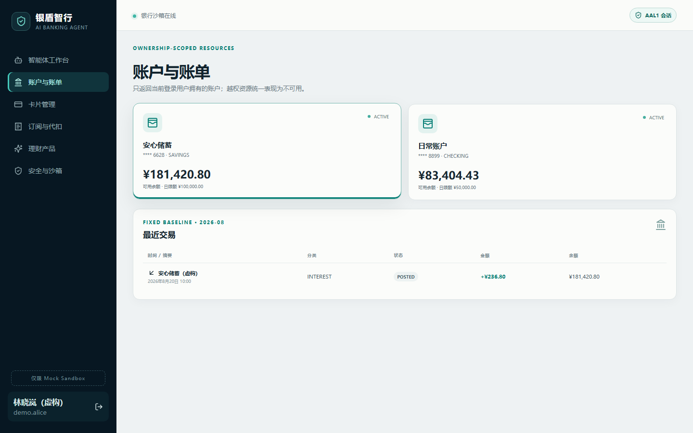
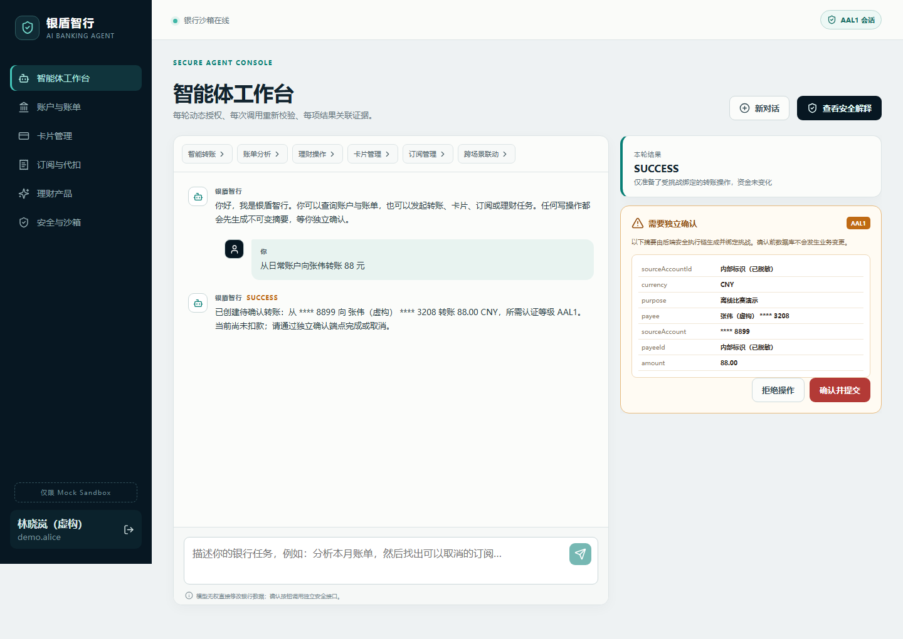
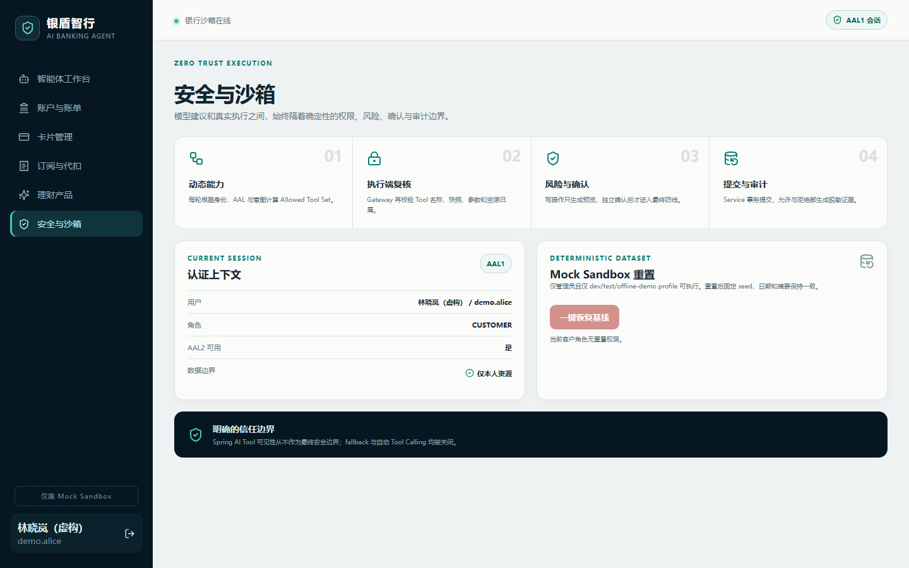

# 银盾智行

面向个人银行业务的安全可信 AI Banking Agent，2026 FinTechathon 深圳国际金融科技大赛参赛项目。

我们想解决的问题很直接：当用户用自然语言让智能体查账、转账或购买理财时，系统不但要把事情办对，还要能说明“为什么允许”“为什么拒绝”，并保证模型本身没有越权执行能力。

项目使用完全虚构、可重复生成的银行数据。默认的 `offline-demo` 模式无需模型密钥或公网连接，拉取代码后即可完整演示。

下面三张截图来自本地 Docker 演示环境，使用的都是仓库内置虚构数据。

账户与账单页面：只展示当前登录用户拥有的资源，账号默认脱敏。



Agent 转账场景：系统已生成待确认操作，但尚未扣款，也没有替用户点击确认。



安全与沙箱页面：把动态能力、执行端复核、风险确认和审计边界直接展示出来。



## 可以演示什么

| 场景 | 示例 |
|---|---|
| 智能转账 | “从日常账户向张伟转账 88 元” |
| 账单分析 | “分析尾号 8899 账户最近 30 天账单” |
| 理财操作 | 查询产品、完成适当性检查并生成购买确认单 |
| 卡片管理 | 冻结或解冻卡片，调整线上、境外和限额控制 |
| 订阅管理 | 识别周期支出、分析订阅成本并取消订阅 |
| 跨场景联动 | “分析账单，然后取消视频订阅” |

查询类任务可以自动完成。涉及资金、卡片状态、订阅取消和理财购买的任务只会先生成待确认操作；确认前不会改变余额或业务状态。

## 安全执行方式

模型只负责理解请求、规划步骤和提出 Tool Call，不负责授权，也不能直接访问数据库。每轮对话会根据当前用户、认证等级和请求上下文计算 Allowed Tool Set；即使某个 Tool 没有暴露给模型，执行端仍会再次校验。

```text
Agent 提议 Tool Call
        ↓
SecureToolGateway
        ↓
Tool 白名单与参数校验
        ↓
身份、资源权限与风险检查
        ↓
生成待确认操作（写操作）
        ↓
用户独立确认 / 必要时 AAL2
        ↓
最终安全复核 → Service → Database → Audit Log
```

几个关键约束：

- 用户身份只来自服务端安全上下文，不接受模型传入的 `userId`。
- Agent 和 Tool Handler 均不能直接依赖 Repository，边界由 ArchUnit 持续检查。
- Tool Registry 精确匹配名称和版本，不启用 resolution fallback。
- ChatClient 自动 Tool Calling 已关闭，所有调用由应用自己的循环控制。
- 确认单与原始参数、用户、认证等级和风险结论绑定；确认时重新检查状态，防止 TOCTOU。
- 页面上的允许、拒绝和风险说明来自安全执行链产生的证据，不由模型自由编造。

更完整的设计见[安全执行模型](docs/security-execution-model.md)和[安全论证](docs/delivery/security-case.md)。

## 快速启动

需要 Docker Desktop（含 Docker Compose）。Windows 上运行验收脚本还需要 PowerShell 7。

```powershell
git clone https://github.com/zhanglonglong01/silver-shield-banking-agent.git
Set-Location silver-shield-banking-agent
docker compose up --build -d --wait
```

启动完成后：

- Web：<http://127.0.0.1:3000>
- Swagger UI：<http://127.0.0.1:8080/swagger-ui.html>
- OpenAPI：<http://127.0.0.1:8080/v3/api-docs>
- 健康检查：<http://127.0.0.1:8080/actuator/health>

默认端口只绑定到 `127.0.0.1`。带有固定演示凭据和 Sandbox reset 能力的环境不应直接暴露到公网。

### 演示账号

| 用户名 | 密码 | 说明 |
|---|---|---|
| `demo.alice` | `Demo@2026!` | 主要演示账号 |
| `demo.bob` | `Demo@2026!` | 用于验证跨用户资源隔离 |
| `demo.locked` | `Demo@2026!` | 用于演示锁定账号拒绝 |
| `demo.admin` | `Admin@2026!` | 仅用于重置开发/演示数据 |

演示环境的 AAL2 验证码为 `246810`，仅用于虚构 Sandbox。

停止服务：

```powershell
docker compose down
```

## 可复现的 Mock Banking Sandbox

仓库不包含真实个人信息或银行数据。模拟用户、账户、银行卡、流水、收款人、订阅和理财产品由固定规则生成：

- Dataset version：`fintechathon-demo-v2`
- Random seed：`2026`
- Baseline date：`2026-08-31`

一键重置：

```powershell
pwsh ./scripts/reset-sandbox.ps1
```

连续 reset 后，资源内容和规范化摘要保持一致。`prod` profile 不注册初始化器、reset endpoint 或固定码 AAL2 能力。

## 测试与验收

```powershell
# 端到端验收：登录、Agent 场景、越权、注入、注销、OpenAPI 等
pwsh ./scripts/acceptance.ps1

# 后端测试（本机需 JDK 17，集成测试需 Docker）
./mvnw.cmd test

# 前端测试
Set-Location frontend
npm install
npm test
npm run test:e2e

# Docker 演示环境启动后，可重新生成 README 截图
npm run screenshots
```

2026-09-11 的交付验收结果：

| 检查项 | 结果 |
|---|---|
| 后端 JUnit / Testcontainers / ArchUnit | 162/162 通过 |
| 前端 Vitest | 12/12 通过 |
| Playwright 浏览器场景 | 9/9 通过 |
| Docker 冷启动与健康检查 | API、Web、MySQL、Redis 全部 healthy |
| API/Agent 一键验收 | 9/9 通过 |
| 只读并发烟测 | 100/100，0 failure，p95 23 ms |
| 前端依赖审计 | 0 vulnerability |

测试覆盖正常、异常、未认证、越权、Prompt Injection、幻觉 Tool/ID/数字、确认过期与重放、幂等、并发确认和依赖故障。原始命令与范围说明见[测试报告](docs/delivery/test-report.md)。

## 技术栈

- Java 17、Spring Boot 3、Spring Security、Spring AI
- MySQL 8、Redis、Flyway
- Vue 3、TypeScript、Vite、Pinia
- JUnit 5、Testcontainers、ArchUnit、Vitest、Playwright
- REST API、OpenAPI 3、Docker Compose

后端采用模块化单体。`BankingModelClient` 将 Agent 与具体模型 Provider 解耦：默认使用确定性的离线演示实现；配置 `dev` profile 和外部环境变量后，也可以接入 OpenAI-compatible Provider。密钥不应写入仓库或 `.env.example`。

## 项目结构

```text
src/main/java/       后端领域、应用服务、安全网关与 Agent
src/main/resources/  配置与 Flyway migration
src/test/            单元、集成、架构和攻击场景测试
frontend/            Vue 3 演示前端
scripts/             reset、验收、备份、故障与并发烟测脚本
docs/                架构、安全、ER 模型和比赛交付材料
compose.yml          本地完整部署入口
```

进一步阅读：

- [系统架构](docs/architecture.md)
- [数据库 ER 模型](docs/database-er.md)
- [Tool Catalog](docs/tool-catalog.md)
- [测试策略](docs/testing-strategy.md)
- [比赛演示脚本](docs/delivery/demo-script.md)
- [部署与运维手册](docs/delivery/operations-runbook.md)
- [交付材料索引](docs/delivery/README.md)

## 当前边界

这是面向比赛演示和安全机制验证的工程版本，不是可以直接接入真实银行核心系统的生产产品。目前需要注意：

- 默认 `offline-demo` 是为可重复演示设计的确定性 Provider；真实模型行为需在单独 profile 下验证。
- AAL2 使用固定 Sandbox 验证码，没有接入真实 OTP、设备绑定或银行认证系统。
- 对话计划、部分 Evidence 和签名状态仍偏单实例设计，横向扩展前需迁移到共享存储与受管密钥。
- 前端为演示便利使用 `sessionStorage` 保存 token；生产环境应改用 BFF 与安全 Cookie。
- 100 请求测试只是本机烟测，不代表生产容量或金融合规认证。
- 当前 Flyway 版本对 MySQL 8.4 会给出正式测试范围警告；本项目迁移、Compose 和自动化测试均已通过，但升级前仍需重新评估兼容性。

本项目中的用户、账户、交易和产品均为虚构数据，所有结果仅用于技术演示，不构成金融建议，也不代表任何真实金融机构。
