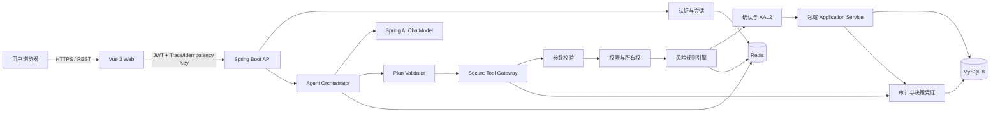
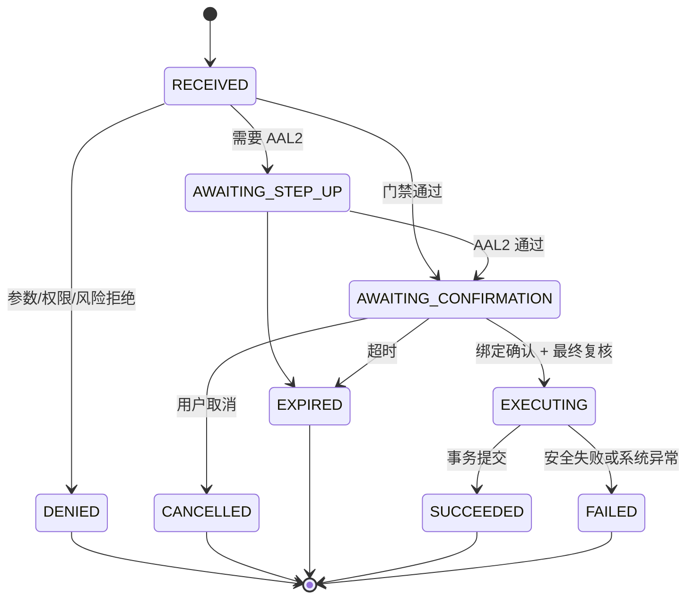

# 系统架构设计

## 1. 架构选择

项目采用**前后端分离的模块化单体**。后端打包为一个 Spring Boot JAR，领域之间以 Java 包、端口接口和 ArchUnit 规则隔离；部署时只有 Web、API、MySQL、Redis 四类核心容器。该选择能在比赛周期内减少分布式事务和运维成本，又保留未来拆分领域服务的边界。

### 架构目标

- 让自然语言体验与资金安全解耦：更换模型不会改变授权和执行结果。
- 对 LLM、用户输入、历史对话、商户文本和 Tool 参数均按不可信输入处理。
- 写操作在确认前零副作用；确认后以数据库事务和幂等键保证至多一次业务效果。
- 每一个结论和决策都有证据 ID、策略版本、规则命中和 Trace ID。
- 支持离线 Stub Model、可选本地模型和 OpenAI-compatible 模型，测试不依赖外部网络。
- Tool 对模型“不可见”只属于纵深防御，不构成授权结论；执行端必须独立验证当前 Capability Policy。

## 2. 容器与依赖关系



模型只连接 Agent Orchestrator。模型没有数据库凭证，不持有 Repository 或 Application Service 引用，也不能构造任意类名、URL、SQL 或 Tool 名称。

### Capability / Tool Policy 双重门禁

M2 已实现每个请求动态生成不可变 `AllowedToolSetSnapshot`；未来 Agent Loop 直接复用该机制：

```text
CapabilityPolicy.issue(
  serverPrincipal + assuranceLevel + requestId + channel,
  requestedCandidateToolIds
) -> signed allowed definitions + denied candidates + policyVersion + expiresAt
```

1. Agent 只把快照中的 ToolCallback 通过 request-level `.tools(...)` 暴露给模型。
2. 不为高风险或写操作注册 `defaultTools`；本项目默认不注册任何共享业务 `defaultTools`。
3. 模型返回 Tool Call 后，Secure Tool Gateway 根据服务端上下文重新取得/复核策略快照，并验证精确的 `(toolName, version)` 是否仍在 Allowed Tool Set。
4. Tool 未暴露、策略快照过期、上下文变化或执行端集合不包含该 Tool 时，一律 `TOOL_NOT_ALLOWED`；绝不依赖模型侧 JSON Schema 作为最终安全边界。
5. M2 快照使用进程内 HMAC-SHA256 保护完整性，并绑定 `requestId + userId + role + AAL + policyVersion + expiresAt + descriptorDigest`；最终成员检查结果写入 `tool_security_audit`。

M2 实际执行链为：

```text
Principal → CapabilityPolicy → AllowedToolSetSnapshot
          → SecureToolGateway
          → snapshot/context/member verification
          → ExplicitToolRegistry exact (name, version)
          → descriptor digest and READ_ONLY check
          → strict Jackson + Bean Validation + semantic validation
          → Tool Handler → BankingReadUseCase
          → allow/deny/error audit (arguments hash only)
```

框架级 Tool resolution fallback 永久关闭，ChatClient 自动 Tool Calling 永久关闭；未来由应用维护用户控制、逐步可观察的 Tool Calling Loop。

## 3. 逻辑分层

| 层 | 职责 | 明确禁止 |
|---|---|---|
| REST/API | 登录、聊天、确认、取消、操作状态、审计解释、统一响应 | 不写领域状态，不信任前端传入的 userId/role |
| Agent | 意图识别、槽位补全、最多 8 步任务计划、多轮状态、结果表述 | 不访问 Repository，不做授权裁决，不计算余额/收益/账单总额 |
| Tool Contract | 公开给模型的固定 JSON Schema、描述、版本和返回信封 | 不暴露内部实体、SQL、全卡号、规则阈值或密钥 |
| Secure Tool Gateway | 白名单路由、参数/权限/风险/确认/幂等编排 | 未完成门禁不得调用写 Service |
| Domain/Application | 转账、账单、理财、卡片、订阅的确定性用例 | 不接受模型身份，不绕过操作单执行写入 |
| Infrastructure | JPA/JDBC、Redis、模型适配、时钟、消息与配置 | 不向上泄漏数据库对象 |
| Audit/Evidence | 追加式审计、请求摘要、规则快照、解释视图 | 不保存敏感 Prompt、口令、OTP、完整账号卡号 |

## 4. 领域边界

### Identity & Access

管理演示用户、角色、权限、认证等级（AAL1/AAL2）和资源所有权。RBAC 决定“是否具有某类能力”，ABAC 决定“是否能操作这个具体资源”。

### Account & Billing

提供本人账户、余额、流水和账单分析。所有聚合、分类统计、周期识别和异常分数由 Java 代码产生；LLM 仅将结构化结果转为自然语言，并引用证据。

### Transfer

管理转账预览、转账操作单、余额/限额校验、借贷记账和回执。内部转账在一个 MySQL 事务内完成；外部收款人在沙箱中只产生模拟出账。

### Investment

管理产品、风险等级、适当性、订单和持仓。购买在同一事务内扣减可用余额、生成订单、写账和更新持仓。

### Card

管理银行卡状态、线上/境外开关和限额。合法状态转换由状态机控制；冻结与解冻不能通过直接字段更新实现。

### Subscription

管理已识别的订阅/代扣、下次扣款、取消影响和取消记录。交易流水识别只产生候选，不自动取消。

### Agent & Conversation

管理对话、消息、结构化会话状态、Agent Run、任务计划与步骤。Redis 保存短期活动状态，MySQL 保存必要检查点和审计关联。

### Safe Execution

管理 Tool 注册表、操作单、参数摘要、策略决策、确认挑战、幂等、风险规则和审计事件，是所有写领域的唯一入口。

## 5. Agent 运行模型

### 5.1 输入阶段

1. REST 层从认证上下文取得用户，分配 `traceId`，限制消息长度和速率。
2. 输入安全器标记指令覆盖、索取系统 Prompt、伪造 Tool 结果、SQL/代码执行等可疑模式。
3. 用户文本始终放入 `UNTRUSTED_USER_CONTENT` 数据区；交易描述、收款人备注等检索内容放入 `UNTRUSTED_BANK_DATA` 数据区。
4. 高风险注入不是简单“靠关键词拦截”：即使检测漏报，后续白名单、Schema、权限和风险门禁仍默认拒绝。

### 5.2 意图与计划

Agent 生成受 JSON Schema 约束的 `TaskPlan`：

```json
{
  "intent": "TRANSFER",
  "requiresClarification": false,
  "steps": [
    {
      "stepId": "s1",
      "tool": "beneficiary.search_owned",
      "dependsOn": [],
      "arguments": {"query": "张伟"}
    },
    {
      "stepId": "s2",
      "tool": "transfer.preview",
      "dependsOn": ["s1"],
      "arguments": {"amount": "800.00", "currency": "CNY"}
    }
  ]
}
```

计划验证器确定性检查：步骤数不超过 8、无环、Tool 在当前用户的运行时白名单内、依赖引用存在、参数满足静态 Schema、查询结果没有被模型伪造。依赖步骤产生的 ID 通过服务端变量绑定写入，模型不能用文本冒充 Tool 输出。

### 5.3 多轮状态

会话状态只保存结构化槽位和服务端锚点：

- `activeIntent`、`missingSlots`、`pendingPlanId`、`pendingOperationIds`
- 已展示给用户的 `accountId/beneficiaryId/productId/cardId/subscriptionId` 锚点
- 上一次 Tool Result 的 evidence IDs 与过期时间
- 对话版本号和最近活动时间

聊天原文不是权限事实。任何跨轮引用都要重新解析到服务端锚点，并在执行时重查所有权和当前状态。Redis 丢失时可以从 MySQL 检查点恢复；无法安全恢复则重新询问，不猜测。

## 6. 写操作生命周期



确认卡展示不可变摘要，包括来源账户掩码、收款人/产品/卡片/订阅、金额、手续费、影响、风险提示和有效期。确认记录绑定 `userId + operationId + canonicalArgumentsHash + summaryHash + expiresAt`，一次性消费。确认后仍复查所有权、余额、限额、资源版本和风险，避免确认期间状态变化。

## 7. 查询与证据约束

查询 Tool 返回 `evidence[]`：每条证据含 `evidenceId`、类型、数据版本、来源记录 ID（对模型脱敏）和生成时间。最终回答的金额、日期、状态、产品风险级别等可验证事实必须引用 evidence ID。

Grounding Validator 执行以下规则：

- Tool 未返回的账号、余额、交易、费率、状态不能作为事实陈述。
- 金额聚合必须来自账单分析 Tool，不能让模型心算。
- ID 必须来自当前用户已授权 Tool Result 或服务端变量绑定。
- Tool 失败或数据为空时必须明确说明，禁止用常识补齐银行事实。
- 对无法自动校验的开放文本，使用“建议/可能”措辞并与业务事实分开。

## 8. Redis 与 MySQL 职责

**MySQL 是唯一业务事实源**：账户余额、流水、操作单、确认状态、订单、持仓、卡片、订阅、风险决策和审计均持久化。

**Redis 仅用于可重建状态**：短期会话缓存、滑动窗口风险计数、限流、短锁、已展示资源锚点缓存。Redis 故障时系统应降级为数据库查询或拒绝高风险操作，绝不能跳过风险检查。

## 9. 可用性与异常处理

- 统一错误码分为 `VALIDATION_*`、`AUTH_*`、`RISK_*`、`CONFIRMATION_*`、`IDEMPOTENCY_*`、`DOMAIN_*`、`TOOL_*`、`SYSTEM_*`。
- 返回用户的是安全描述、Trace ID 和可恢复动作；堆栈、SQL、Prompt 和内部类名只进入受控技术日志。
- 查询 Tool 可对瞬时错误做有限重试；写 Tool 只允许凭相同幂等键重试。
- 模型超时不改变已生成操作单；用户可查询操作状态。数据库提交结果优先于模型生成的自然语言。
- Redis 风险计数不可用时，高风险操作 fail closed；普通只读查询可按配置降级。

## 10. 部署拓扑

Docker Compose 规划服务：

- `web`：Nginx 托管 Vue 静态资源并反代 `/api`
- `api`：Spring Boot 应用，非 root 用户运行
- `mysql`：MySQL 8，持久卷，仅内网开放
- `redis`：Redis，持久化非业务强依赖，仅内网开放
- `model`（可选 profile）：本地模型服务；也可通过环境变量连接 OpenAI-compatible API

密钥从环境变量或 Docker Secret 注入，不写入 Git。演示数据 profile 与任何未来生产 profile 隔离；应用启动时校验 `sandbox=true` 和数据集版本并在 UI 显著标识“模拟环境”。

## 11. 架构强制规则

以下约束必须由 ArchUnit 和集成测试自动验证：

1. `agent..` 不得依赖 `..repository..`、JPA Entity 或领域写 Service。
2. Tool 实现不得直接依赖 Repository，只能调用 `SecureToolGateway` 或只读 Query Port。
3. 写 Application Service 仅能由已验证的 `AuthorizedOperationContext` 调用。
4. Repository 不接受裸 `userId` 由模型传入；本人查询必须带服务端 Principal Scope。
5. 所有写方法必须处于事务中，并在同一操作 ID 下生成审计结果。
6. Tool 注册必须声明版本、风险级别、所需权限、参数 Schema 和是否确认。
7. `agent..` 和 `tool..` 均不得依赖任何 `..repository..`；该规则从 M1 起即使包中只有边界占位类也持续执行。
8. Tool 执行前必须存在有效 Capability Policy snapshot，且 `(toolName, version)` 属于当前 Allowed Tool Set。

## 12. M1 实现边界

M1 只实现可靠 Banking Sandbox、Flyway、MySQL/Redis、基础认证、AAL1 数据模型、本人资源查询、Docker Compose 和测试基础。`agent..`、`tool..` 仅建立未来边界和 ArchUnit 约束；不添加 Spring AI 依赖，不实现 LLM、Planner、Tool Calling Loop、RAG、Capability Policy 运行时代码或业务 Tool。
