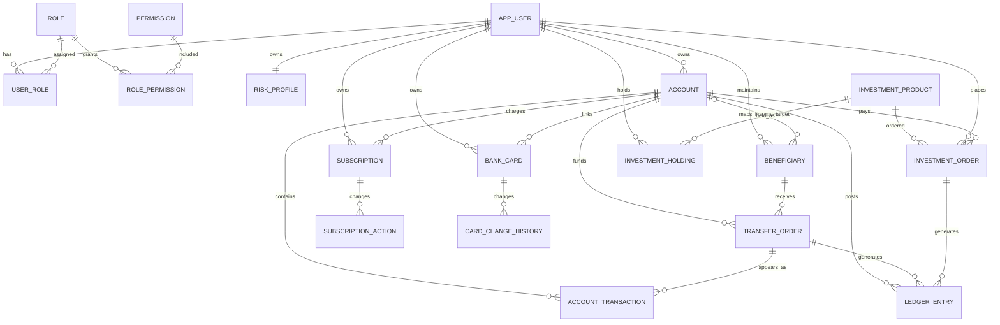
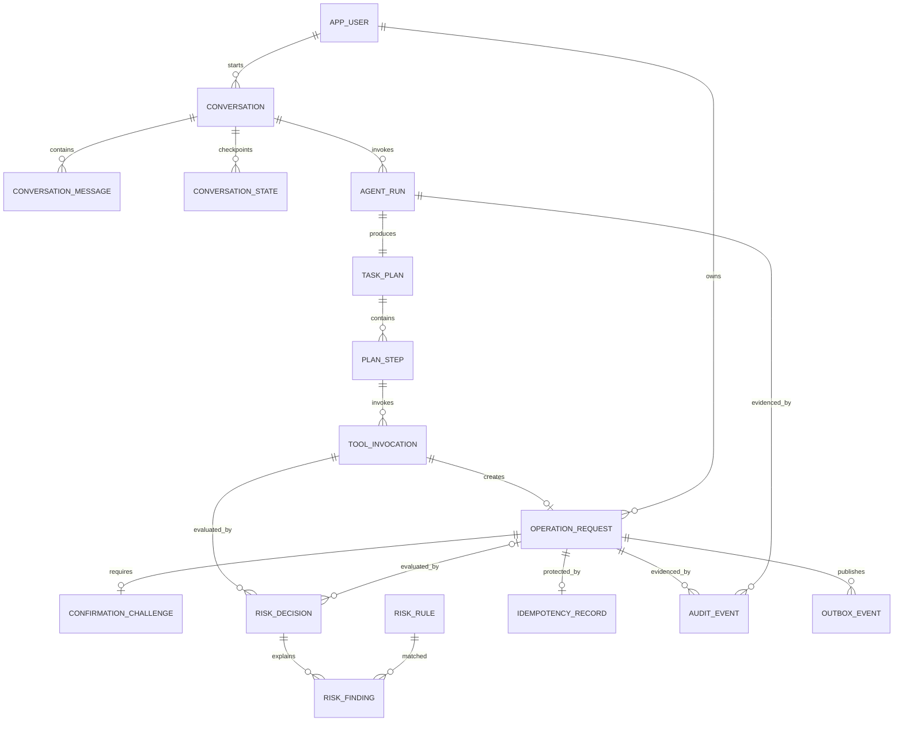

# 数据库 ER 模型与 Mock Sandbox

## 1. 建模约定

- MySQL 8，默认字符集 `utf8mb4`，时间使用 `TIMESTAMP(6)` 并以 UTC 写入。
- 主键使用 `CHAR(36)` UUID，便于比赛期间排障；外部永不暴露自增序列。
- 金额使用 `DECIMAL(19,4)`，API 使用十进制字符串；币种为 `CHAR(3)`。
- 状态和类型在 Java 中使用 enum，在数据库中存 `VARCHAR` 并由 Flyway 建 CHECK 约束。
- 可变聚合根包含 `version BIGINT NOT NULL` 进行乐观锁控制。
- 所有本人资源都直接或可传递关联 `user_id`，Repository 查询必须同时带 Principal Scope。
- 账号、卡号均为纯虚构号码；模型和前端只接收掩码。用于匹配的值保存为沙箱 token/hash，不保存真实敏感数据。
- JSON 只用于规则快照、参数快照和展示摘要；金额、状态、所有权等关键字段必须结构化。

## 2. 业务 ER 图



## 3. Agent、安全与审计 ER 图



## 4. 核心数据字典

### 4.1 身份与权限

| 表 | 关键字段 | 约束/说明 |
|---|---|---|
| `app_user` | `id`, `username`, `password_hash`, `display_name`, `status`, `created_at`, `version` | `username` 唯一；只保存演示密码哈希 |
| `role` | `id`, `code`, `name` | 预置 `CUSTOMER`, `DEMO_ADMIN` |
| `permission` | `id`, `code`, `name` | 细分 VIEW/TRANSFER/INVEST/CARD/SUBSCRIPTION/AUDIT |
| `user_role` | `user_id`, `role_id` | 联合主键 |
| `role_permission` | `role_id`, `permission_id` | 联合主键 |
| `risk_profile` | `user_id`, `risk_level`, `score`, `questionnaire_version`, `assessed_at`, `expires_at`, `version` | 理财适当性事实；`R1` 至 `R5` |

认证会话和 AAL2 短期证明优先保存在 Redis；必要的认证成功/失败事件进入审计，不在业务表保存明文 OTP。

### 4.2 账户与账单

| 表 | 关键字段 | 约束/说明 |
|---|---|---|
| `account` | `id`, `user_id`, `account_token`, `account_masked`, `alias`, `account_type`, `currency`, `ledger_balance`, `available_balance`, `status`, `daily_transfer_limit`, `version` | `account_token` 唯一；余额非负规则由领域和数据库共同保护 |
| `account_transaction` | `id`, `account_id`, `booking_time`, `direction`, `amount`, `currency`, `category_code`, `merchant_name`, `description`, `counterparty_masked`, `source_type`, `source_id`, `status`, `balance_after` | `amount > 0`；展示流水和账单分析事实源 |
| `ledger_entry` | `id`, `account_id`, `operation_id`, `entry_type`, `amount_delta`, `currency`, `balance_after`, `created_at` | 追加式；`(operation_id, account_id, entry_type)` 唯一防重复记账 |
| `beneficiary` | `id`, `user_id`, `name`, `bank_name`, `account_token`, `account_masked`, `internal_account_id`(nullable), `currency`, `status`, `trusted`, `last_used_at`, `version` | 只允许引用当前用户的收款人 ID；内部映射仍不授予对目标账户的查询权 |

`account_transaction` 是用户可见账单，`ledger_entry` 是不可变记账证据。写 Service 在同一事务内锁定账户、更新余额、写 ledger、写 statement transaction 和业务单据。

### 4.3 转账

| 表 | 关键字段 | 约束/说明 |
|---|---|---|
| `transfer_order` | `id`, `operation_id`, `user_id`, `source_account_id`, `beneficiary_id`, `amount`, `fee`, `currency`, `purpose`, `status`, `risk_decision_id`, `created_at`, `completed_at`, `failure_code`, `version` | `operation_id` 唯一；业务效果的幂等屏障 |

状态：`PENDING`、`SUCCEEDED`、`FAILED`。只有已授权的操作上下文可以创建。内部收款账户可通过沙箱映射产生一借一贷；外部模拟收款人仅借记来源账户并生成外部出账标记。

### 4.4 银行卡

| 表 | 关键字段 | 约束/说明 |
|---|---|---|
| `bank_card` | `id`, `user_id`, `linked_account_id`, `card_token`, `card_masked`, `card_type`, `status`, `online_enabled`, `overseas_enabled`, `single_tx_limit`, `daily_limit`, `expiry_month`, `version` | 合法状态机：ACTIVE/FROZEN/LOST/CLOSED；不保存 CVV |
| `card_change_history` | `id`, `card_id`, `operation_id`, `change_type`, `before_value_json`, `after_value_json`, `reason`, `changed_at` | `operation_id` 唯一；追加式状态/控制变更记录 |

### 4.5 订阅与代扣

| 表 | 关键字段 | 约束/说明 |
|---|---|---|
| `subscription` | `id`, `user_id`, `charge_account_id`, `merchant_name`, `service_name`, `amount`, `currency`, `billing_cycle`, `next_charge_date`, `status`, `detected_from`, `cancellation_effect`, `version` | 状态 ACTIVE/PAUSED/CANCELLED/EXPIRED |
| `subscription_action` | `id`, `subscription_id`, `operation_id`, `action`, `before_status`, `after_status`, `effective_at`, `created_at` | `operation_id` 唯一，保存取消结果 |

流水分析可以生成订阅候选，但只有用户确认后的 `subscription.cancel` 才能改变状态。

### 4.6 理财

| 表 | 关键字段 | 约束/说明 |
|---|---|---|
| `investment_product` | `id`, `code`, `name`, `product_type`, `risk_level`, `currency`, `min_purchase`, `increment_amount`, `expected_yield_text`, `term_days`, `sale_status`, `valid_from`, `valid_to`, `version` | 收益只保存模拟说明，不承诺回报 |
| `investment_order` | `id`, `operation_id`, `user_id`, `product_id`, `payment_account_id`, `amount`, `currency`, `risk_profile_snapshot`, `product_snapshot`, `status`, `created_at`, `confirmed_at`, `version` | `operation_id` 唯一；快照用于审计适当性 |
| `investment_holding` | `id`, `user_id`, `product_id`, `units`, `cost_amount`, `currency`, `opened_at`, `updated_at`, `version` | `(user_id, product_id)` 可唯一，按产品规则更新 |

### 4.7 对话与计划

| 表 | 关键字段 | 约束/说明 |
|---|---|---|
| `conversation` | `id`, `user_id`, `title`, `status`, `created_at`, `last_active_at`, `version` | 用户只能访问自己的会话 |
| `conversation_message` | `id`, `conversation_id`, `role`, `content_redacted`, `content_hash`, `security_labels_json`, `created_at` | 敏感内容先脱敏；可按配置不持久化完整原文 |
| `conversation_state` | `id`, `conversation_id`, `state_version`, `active_intent`, `slots_json`, `anchor_ids_json`, `pending_operation_ids_json`, `expires_at`, `created_at` | 追加检查点；Redis 为活动副本 |
| `agent_run` | `id`, `conversation_id`, `trigger_message_id`, `model_provider`, `model_name`, `prompt_version`, `status`, `started_at`, `ended_at`, `trace_id` | 不保存隐式 CoT；只存结构化摘要和计量 |
| `task_plan` | `id`, `agent_run_id`, `intent`, `plan_version`, `plan_hash`, `status`, `validation_errors_json`, `created_at` | 计划原文规范化后哈希 |
| `plan_step` | `id`, `plan_id`, `step_key`, `tool_name`, `tool_version`, `arguments_template_json`, `depends_on_json`, `status`, `result_evidence_ids_json`, `version` | `(plan_id, step_key)` 唯一 |

### 4.8 安全执行

| 表 | 关键字段 | 约束/说明 |
|---|---|---|
| `tool_invocation` | `id`, `agent_run_id`, `plan_step_id`, `tool_name`, `tool_version`, `arguments_hash`, `arguments_redacted_json`, `status`, `started_at`, `ended_at`, `error_code`, `trace_id` | 每次调用留痕，敏感参数不落明文 |
| `operation_request` | `id`, `user_id`, `conversation_id`, `plan_step_id`, `tool_name`, `tool_version`, `canonical_args_json`, `args_hash`, `display_summary_json`, `summary_hash`, `required_permission`, `required_aal`, `status`, `expires_at`, `result_ref_type`, `result_ref_id`, `failure_code`, `version`, `created_at`, `updated_at` | 业务参数不可在确认后修改；状态受状态机控制 |
| `confirmation_challenge` | `id`, `operation_id`, `user_id`, `challenge_hash`, `binding_hash`, `status`, `attempt_count`, `expires_at`, `confirmed_at`, `consumed_at`, `version` | `operation_id` 唯一；PENDING/CONFIRMED/CONSUMED/EXPIRED/CANCELLED |
| `risk_rule` | `id`, `rule_code`, `domain`, `version`, `priority`, `enabled`, `condition_json`, `effect`, `reason_template`, `valid_from`, `valid_to` | 规则版本不可原地覆盖，新增版本 |
| `risk_decision` | `id`, `tool_invocation_id`, `operation_id`(nullable), `evaluation_phase`, `outcome`, `policy_version`, `input_hash`, `reason_codes_json`, `created_at` | 拒绝可能发生在操作单创建前；PRE_CONFIRM/FINAL_GUARD，ALLOW/CONFIRM/STEP_UP/DENY |
| `risk_finding` | `id`, `decision_id`, `rule_id`, `rule_code`, `effect`, `reason_code`, `facts_redacted_json` | 支撑“为什么” |
| `idempotency_record` | `id`, `user_id`, `scope`, `idempotency_key_hash`, `request_hash`, `operation_id`, `status`, `response_ref`, `expires_at`, `created_at` | `(user_id, scope, idempotency_key_hash)` 唯一；同 key 异参冲突 |
| `audit_event` | `id`, `trace_id`, `operation_id`, `sequence_no`, `actor_type`, `actor_id`, `stage`, `action`, `outcome`, `reason_code`, `policy_version`, `resource_type`, `resource_id_masked`, `details_redacted_json`, `request_hash`, `previous_hash`, `event_hash`, `occurred_at` | 追加式；`(trace_id, sequence_no)` 唯一；同 Trace 哈希链 |
| `outbox_event` | `id`, `operation_id`, `event_type`, `payload_redacted_json`, `status`, `created_at`, `published_at` | 后续 UI 通知/异步扩展；与业务事务同写 |

## 5. 索引与一致性要求

必须建立的索引/唯一约束：

- 所有权查询：`account(user_id,status)`、`bank_card(user_id,status)`、`beneficiary(user_id,name,status)`、`subscription(user_id,status)`。
- 账单：`account_transaction(account_id,booking_time)`、`account_transaction(account_id,category_code,booking_time)`。
- 写入幂等：所有领域写表 `operation_id UNIQUE`；`idempotency_record` 联合唯一。
- 操作恢复：`operation_request(user_id,status,expires_at)`、`confirmation_challenge(operation_id,status)`。
- 风险速度：MySQL 索引 `transfer_order(user_id,created_at,status)`；Redis 提供滑窗加速但不是唯一依据。
- 审计：`audit_event(trace_id,sequence_no)`、`audit_event(operation_id,occurred_at)`。

余额变更使用账户行锁或带版本/余额条件的原子更新。确认消费使用条件更新 `status=CONFIRMED` 或行锁，保证两个并发请求最多一个进入执行。业务事务提交时同时写成功审计；事务失败后的失败审计使用独立事务记录，不伪造业务成功。

## 6. Flyway 迁移规划

M1 已实际创建且后续不可改写的迁移：

```text
V001__identity_and_sandbox_metadata.sql
V002__banking_sandbox_domain.sql
```

后续从 `V003` 起只做追加迁移，规划包含细化权限、ledger/transfer、Agent/Conversation、Safe Execution、Audit/Outbox 和版本化规则，不回写 M1 migration。迁移只负责结构和稳定参考数据。大批量 Mock 交易由版本化 `SandboxDatasetGenerator` + `SandboxDatasetStore` 生成，避免把随机运行逻辑放入迁移；生成器本身有确定性测试，持久化后以 SHA-256 dataset digest 验证。

## 7. 可复现 Mock Banking Sandbox

### 数据集元数据

- `datasetId`: `fintechathon-demo-v1`
- 随机种子：`2026`
- 固定基准日：`2026-08-31`
- 固定时钟：测试默认 `2026-09-01T02:00:00Z`
- 生成方式：`SplittableRandom(2026)` + 固定 UUID namespace + 固定商户模板
- 重置方式：仅 `demo` profile 的管理员端点/脚本；事务内校验目标数据集后重建，不允许在其他 profile 启用

### 预置人物

| 用户 | 用途 | 数据轮廓 |
|---|---|---|
| `demo.alice` | 主演示用户 | 2 个 CNY 账户、2 张卡、5 个收款人、6 个订阅、180 天流水、2 个持仓，风险 R3 |
| `demo.bob` | 越权隔离对照 | 1 个账户、1 张卡、独立收款人/流水/订阅，风险 R2 |
| `demo.locked` | 认证拒绝 | 用户状态 LOCKED，无有效会话 |

演示密码通过启动环境变量注入默认值并仅保存 BCrypt/Argon2 哈希；UI 明确标识为模拟凭据。

### 可重复业务样本

- Alice 活期可用余额包含可成功的 800 元转账与余额不足的大额失败路径。
- 一个常用可信收款人和一个从未转账的新收款人，用于 AAL2/风险规则对比。
- 流水包含工资、房租、餐饮、交通、购物、医疗，以及视频/音乐/云盘等周期扣款。
- 一个同商户短时重复扣款样本、一个月度消费突增样本，支持账单异常解释。
- 产品覆盖 R1-R5、在售/停售、最低购买额和递增金额，支持适当性允许与拒绝。
- 卡片覆盖 ACTIVE、FROZEN，支持冻结成功、重复冻结幂等、解冻需 AAL2 和非法 CLOSED 转换。
- 订阅覆盖 ACTIVE、CANCELLED 和临近扣款，支持成功取消、重复取消与无权取消。

### 数据集验收哈希

Loader 完成后计算不含密码哈希和运行时间的规范化摘要：用户数、各表行数、账户余额合计、交易金额分类合计和固定记录字段哈希。`GET /api/v1/demo/dataset` 返回数据集版本与摘要，自动化测试断言相同 seed 生成相同摘要。

## 8. 数据保留与脱敏

- 对话原文默认脱敏后保存；系统 Prompt、模型隐式推理、认证 token、OTP 不入库。
- Tool 参数只在操作单保存执行所需的规范化值；审计中使用 hash/掩码。
- 审计事件应用账号仅有 INSERT/SELECT 权限，不具有 UPDATE/DELETE；演示重置使用单独管理员连接。
- 所有演示账号、商户、人名和号码均声明为虚构，不导入用户上传的真实银行数据。
