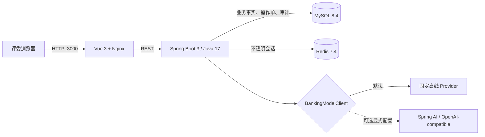
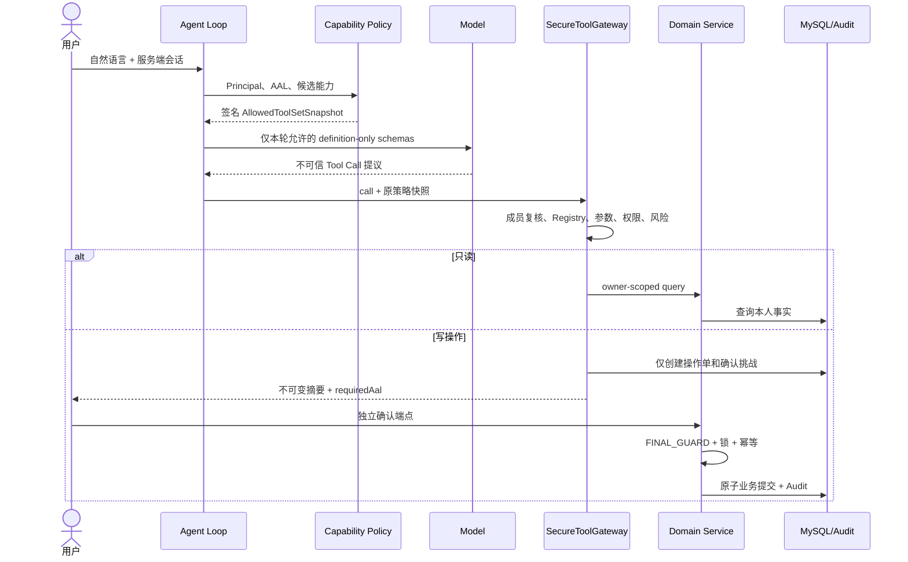

# 交付架构与信任边界

## 部署拓扑

四个容器均带健康探针。浏览器只访问 Nginx；Nginx代理 `/api`、`/v3/api-docs` 和健康检查。数据库和 Redis 不向 Agent 或模型暴露接口。

## 安全执行链

## 强制边界

- Tool 可见性不是授权：模型看不到某 Tool 只是第一层降噪；Gateway 执行时再次验证同一 Allowed Tool Set。
- 不使用 `defaultTools`，Tool resolution fallback 和 ChatClient 自动 Tool Calling均显式关闭。
- Agent 禁止依赖 Repository、Tool Handler 或 Registry；Tool Handler 禁止依赖 Repository。ArchUnit 扫描真实类，避免空包规则 vacuous pass。
- 最终写 Service 不注册为 Tool。对话中的“确认”不能消费 challenge。
- 身份、角色、AAL 和 `userId` 来自服务端认证上下文，模型参数中不存在这些授权字段。
- MySQL 是业务事实源；模型文本、对话历史、Redis 和前端状态都不是授权事实。
