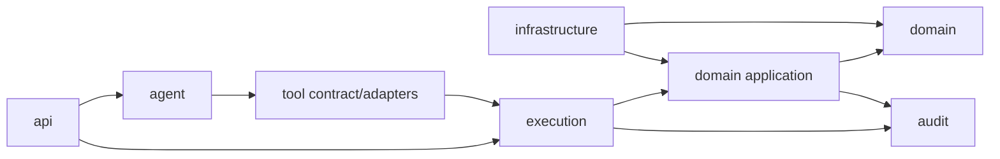

# 项目目录与模块边界

## 1. M1–M4 实际目录

```text
AI_Banking_Agent/
├─ pom.xml / mvnw / mvnw.cmd
├─ Dockerfile / compose.yml / .env.example
├─ src/main/java/com/fintechathon/silvershield/
│  ├─ SilverShieldApplication.java
│  ├─ common/api/                 # 安全错误信封
│  ├─ config/                     # Sandbox、Security、Clock、显式 Tool 装配
│  ├─ security/                   # Redis bearer 会话、AAL1/AAL2、Spring Security
│  ├─ identity/
│  │  ├─ domain/                  # AppUser
│  │  └─ repository/
│  ├─ banking/
│  │  ├─ api/                     # 本人资源 REST API
│  │  ├─ application/             # 带 owner scope 的查询服务
│  │  ├─ domain/                  # Account/Card/Transaction/Payee/Subscription/WealthProduct
│  │  └─ repository/
│  ├─ operation/                  # M4 转账操作单、风控、确认、幂等、回执
│  │  ├─ api/                     # 独立查询/确认 REST；不接受业务参数换参
│  │  ├─ application/             # 最终安全复核与原子转账服务
│  │  ├─ domain/                  # Operation/Challenge/Risk/Idempotency/Transfer/Audit
│  │  └─ repository/
│  ├─ sandbox/                    # 固定生成、持久化、digest、reset
│  ├─ agent/
│  │  ├─ api/                     # POST /api/v1/agent/chat
│  │  ├─ application/             # 自控循环、账单统计、Grounding、限制器
│  │  ├─ conversation/            # 用户绑定、TTL、长度受限的 M3 会话
│  │  ├─ evidence/                # ExecutionEvidence 与结果摘要
│  │  ├─ model/                   # API 状态与返回契约
│  │  └─ provider/                # 厂商无关端口 + Spring AI ChatModel 适配
│  ├─ tool/
│  │  ├─ api/                     # M2 capability/execute REST 演示入口
│  │  ├─ capability/              # Policy、HMAC AllowedToolSetSnapshot
│  │  ├─ gateway/                 # 唯一执行入口、严格参数校验
│  │  ├─ registry/                # 精确 name+version 显式白名单
│  │  ├─ handler/                 # 7 个只读 + 1 个操作查询 + 1 个仅准备转账 Tool
│  │  ├─ schema/                  # snapshot → 动态 Spring AI JSON Schema
│  │  ├─ audit/                   # 审计输出 Port
│  │  └─ model/                   # 无 Spring AI 依赖的 Tool 契约
│  └─ audit/infrastructure/       # JPA 追加式 Tool Security Audit
├─ src/main/resources/
│  ├─ application*.yml
│  └─ db/migration/V001..V004
├─ src/test/java/...              # unit、ArchUnit、Testcontainers
├─ scripts/reset-sandbox.ps1
├─ docs/
└─ README.md
```

M1 已建立工程、认证与 Sandbox；M2 加入 Capability、Registry、Gateway、只读 Handler 与持久化 Tool 审计；M3 加入 Spring AI Provider Adapter、自控 Agent Loop、确定性账单分析、Evidence 和 Grounding；M4 加入 `operation/{api,application,domain,repository}`、AAL2 和安全转账闭环。仍未实现卡片/理财/订阅写操作、Multi-Agent 或 RAG。

## 2. 后续目标目录（M2+）

```text
AI_Banking_Agent/
├─ README.md
├─ docs/
│  ├─ architecture.md
│  ├─ database-er.md
│  ├─ tool-catalog.md
│  ├─ security-execution-model.md
│  ├─ project-structure.md
│  └─ testing-strategy.md
├─ backend/
│  ├─ pom.xml
│  ├─ src/main/java/com/fintechathon/silvershield/
│  │  ├─ SilverShieldApplication.java
│  │  ├─ common/
│  │  │  ├─ api/                 # Result、错误码、分页、Trace ID
│  │  │  ├─ money/               # Money、Currency、精度规则
│  │  │  ├─ time/                # 可注入 Clock
│  │  │  └─ validation/
│  │  ├─ identity/
│  │  │  ├─ api/
│  │  │  ├─ application/
│  │  │  ├─ domain/
│  │  │  └─ infrastructure/
│  │  ├─ account/
│  │  │  ├─ application/         # 账户与账单查询用例
│  │  │  ├─ domain/
│  │  │  ├─ infrastructure/
│  │  │  └─ tool/                # 只读 Tool adapters
│  │  ├─ transfer/
│  │  │  ├─ application/
│  │  │  ├─ domain/
│  │  │  ├─ infrastructure/
│  │  │  └─ tool/
│  │  ├─ investment/
│  │  ├─ card/
│  │  ├─ subscription/
│  │  ├─ agent/
│  │  │  ├─ boundary/            # M1 占位边界；禁止依赖 Repository
│  │  │  ├─ orchestration/       # Chat、Intent、Plan、执行循环
│  │  │  ├─ planning/            # TaskPlan Schema、DAG validator
│  │  │  ├─ conversation/        # 多轮状态与检查点
│  │  │  ├─ grounding/           # 证据约束、幻觉防护
│  │  │  ├─ prompt/              # 固定模板与不可信数据分区
│  │  │  └─ model/               # Spring AI ChatModel 适配端口
│  │  ├─ execution/
│  │  │  ├─ capability/          # Allowed Tool Set policy/snapshot（M2）
│  │  │  ├─ gateway/             # SecureToolGateway 唯一入口
│  │  │  ├─ registry/            # Tool whitelist、版本、Schema
│  │  │  ├─ operation/           # OperationRequest 状态机
│  │  │  ├─ authorization/       # RBAC + ABAC + AAL
│  │  │  ├─ risk/                # 规则、决策、命中解释
│  │  │  ├─ confirmation/        # 挑战、绑定、过期、单次消费
│  │  │  ├─ idempotency/
│  │  │  └─ validation/
│  │  ├─ audit/
│  │  │  ├─ application/
│  │  │  ├─ domain/
│  │  │  └─ infrastructure/
│  │  ├─ sandbox/                # 固定种子 Mock 数据、重置与校验
│  │  └─ config/                 # Spring、Security、Jackson、OpenAPI
│  ├─ src/main/resources/
│  │  ├─ application.yml
│  │  ├─ application-demo.yml
│  │  ├─ application-test.yml
│  │  ├─ db/migration/           # Flyway schema/reference migrations
│  │  ├─ prompts/                # 版本化 system/planner templates
│  │  └─ risk-rules/             # 版本化演示规则配置
│  └─ src/test/
│     ├─ java/...                 # unit/integration/security/architecture
│     └─ resources/
│        ├─ fixtures/
│        └─ agent-cases/          # 注入、幻觉、计划非法样本
├─ frontend/
│  ├─ package.json
│  ├─ vite.config.ts
│  ├─ src/
│  │  ├─ app/                     # router、pinia、bootstrap
│  │  ├─ api/                     # typed REST client
│  │  ├─ features/
│  │  │  ├─ chat/
│  │  │  ├─ confirmation/
│  │  │  ├─ accounts/
│  │  │  ├─ bills/
│  │  │  ├─ transfers/
│  │  │  ├─ investments/
│  │  │  ├─ cards/
│  │  │  ├─ subscriptions/
│  │  │  └─ audit/
│  │  ├─ components/
│  │  ├─ stores/
│  │  └─ types/
│  └─ tests/
│     ├─ unit/
│     └─ e2e/
├─ deploy/
│  ├─ compose.yml
│  ├─ compose.ollama.yml          # 可选本地模型 profile
│  ├─ backend.Dockerfile
│  ├─ frontend.Dockerfile
│  └─ nginx.conf
├─ scripts/
│  ├─ dev-up.ps1
│  ├─ dev-down.ps1
│  ├─ reset-sandbox.ps1
│  └─ verify.ps1
├─ .env.example
├─ .gitignore
└─ .github/workflows/ci.yml
```

原规划中的 Vue 前端、完整 execution/audit 模块和业务写领域留在后续里程碑。后续目录会在当前根 Maven 模块内演进；不会为了匹配示意树而无收益地搬迁 M1 代码。

## 3. 包依赖方向



允许的关键依赖只有向右方向。Infrastructure 实现由 Application/Domain 声明的 Port，通过 Spring 装配反转依赖。

### 只读与写入的边界

- 只读 Tool 可调用领域 `QueryUseCase`，但必须先由 Gateway 完成参数、权限和查询风险检查。
- 写 Tool 只能创建/恢复 `OperationRequest`；只有 Gateway 生成的 `AuthorizedOperationContext` 才能进入 `CommandUseCase`。
- `AuthorizedOperationContext` 是短生命周期、不可序列化、带签名/nonce 的服务端对象，不能由 JSON 反序列化或模型构造。
- Controller 不直接调用领域写用例。确认 Controller 调用 Execution Gateway，由后者完成最终复核再执行。

## 4. REST API 轮廓

M1 已实现：

```text
POST   /api/v1/auth/login
POST   /api/v1/auth/logout
GET    /api/v1/auth/me
GET    /api/v1/auth/assurance

GET    /api/v1/accounts
GET    /api/v1/accounts/{accountId}
GET    /api/v1/accounts/{accountId}/transactions
GET    /api/v1/cards
GET    /api/v1/payees
GET    /api/v1/subscriptions
GET    /api/v1/wealth-products

GET    /api/v1/sandbox/metadata     # 仅 dev/test
POST   /api/v1/sandbox/reset        # 仅 dev/test + DEMO_ADMIN
```

M2 已实现：

```text
POST   /api/v1/tools/allowed        # 动态策略快照；不返回 HMAC
POST   /api/v1/tools/execute        # 当前仅只读；内部统一通过 SecureToolGateway
```

M3 已实现：

```text
POST   /api/v1/agent/chat           # 自然语言只读查询；不返回 chain of thought
```

后续目标：

```text
POST   /api/v1/auth/step-up

POST   /api/v1/conversations
POST   /api/v1/conversations/{conversationId}/messages
GET    /api/v1/conversations/{conversationId}

GET    /api/v1/operations/{operationId}
POST   /api/v1/operations/{operationId}/confirm
POST   /api/v1/operations/{operationId}/cancel

GET    /api/v1/audit/traces/{traceId}/explanation
GET    /api/v1/audit/operations/{operationId}
```

M1 页面型 GET 与 M2 Tool 均从服务端 Principal 取得 user ID；Tool 参数无法提交 `userId`、role 或 AAL。只读 Handler 复用 `BankingReadUseCase` 的 owner scope。当前范围不暴露业务写 REST 接口。

## 5. 配置与 Profile

| Profile | 用途 | 模型 | 数据 |
|---|---|---|---|
| `dev` | 本地开发与 Compose | 默认关闭；可用环境变量启用 OpenAI-compatible | 固定 Mock 数据，可重置 |
| `test` | 自动化测试 | Fake Model；不使用付费模型 | Testcontainers + 固定 Mock 数据，可重置 |
| `llm` | 显式真实模型集成 | Spring AI OpenAI-compatible | 与 test/dev 组合使用 |
| `prod` | 生产安全基线 | 默认关闭；必须显式安全配置 | 不生成 Mock 数据，不装配 reset |
| `demo`（后续） | 比赛演示 | 可配置模型 | 与生产隔离的固定 Mock 数据 |
| `offline-demo`（后续） | 无网络演示兜底 | ScriptedChatModel | 同一 Mock 数据 |

M1 只有 `dev/test` profile 装配 Sandbox initializer、store、reset service 和 controller；`prod` 不装配。未来若扩展真实环境，必须新增独立适配器和安全评审；当前项目不提供真实银行连接能力。

M3 已引入 Spring AI，并持续测试以下 fail-safe 值：

```yaml
spring:
  ai:
    tools:
      resolution:
        fallback:
          enabled: false
    chat:
      client:
        tool-calling:
          enabled: false
```

## 6. 代码约定

- 金额统一使用 `BigDecimal` + ISO 4217 币种；API 中金额使用字符串，禁止 `double`。
- 时间统一使用注入的 `Clock` 和 UTC 持久化，API 返回带时区 ISO-8601。
- ID 使用服务端生成 UUID；模型只能引用已展示 ID，不能生成领域 ID。
- 乐观锁字段统一为 `version`；余额扣减和确认消费使用必要的行锁/条件更新。
- 外部返回使用 DTO，不暴露 JPA Entity。
- Prompt、Tool Schema、风险策略和 Mock 数据均带显式版本。
- 日志使用结构化 JSON，并对账号、卡号、token、Prompt 内容做脱敏或摘要。

## 7. 构建顺序

1. 根工程、Spring Boot、前端、Compose、CI。
2. Common/Identity/Audit/Sandbox 与 Flyway。
3. Execution Kernel：Registry → Validation → Authorization → Risk → Confirmation → Idempotency。
4. Account/Billing 只读垂直切片。
5. Transfer 第一个完整写垂直切片，用它验证执行内核。
6. Investment/Card/Subscription 复用同一安全链。
7. Agent Orchestration 和跨场景计划。
8. 演示 UI、E2E、安全回归和部署加固。
