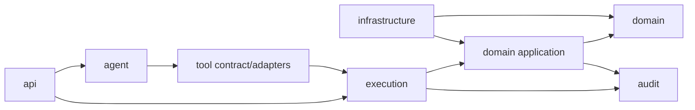

# 项目目录与模块边界

## 1. M1–M8 实际目录

```text
AI_Banking_Agent/
├─ pom.xml / mvnw / mvnw.cmd
├─ Dockerfile / compose.yml / .env.example
├─ src/main/java/com/fintechathon/silvershield/
│  ├─ SilverShieldApplication.java
│  ├─ common/api/                 # 安全错误信封
│  ├─ config/                     # Sandbox、Security、Clock、显式 Tool 装配
│  ├─ security/                   # Redis bearer 会话、AAL1/AAL2、Spring Security
│  ├─ identity/
│  │  ├─ domain/                  # AppUser
│  │  └─ repository/
│  ├─ banking/
│  │  ├─ api/                     # 本人资源 REST API
│  │  ├─ application/             # 带 owner scope 的查询服务
│  │  ├─ domain/                  # 基础资源 + 风险画像/适当性/订单/持仓/变更历史
│  │  └─ repository/
│  ├─ operation/                  # M4/M5 通用操作单、风控、确认、幂等、回执
│  │  ├─ api/                     # 独立查询/确认 REST；不接受业务参数换参
│  │  ├─ application/             # 路由、最终安全复核与原子领域服务
│  │  ├─ domain/                  # Operation/Challenge/Risk/Idempotency/Transfer/Audit
│  │  └─ repository/
│  ├─ sandbox/                    # 固定生成、持久化、digest、reset
│  ├─ agent/
│  │  ├─ api/                     # POST /api/v1/agent/chat
│  │  ├─ application/             # 自控循环、账单统计、Grounding、限制器
│  │  ├─ conversation/            # 用户绑定、TTL、长度受限的 M3 会话
│  │  ├─ evidence/                # ExecutionEvidence 与结果摘要
│  │  ├─ model/                   # API 状态与返回契约
│  │  ├─ planning/                # M6 结构化意图、DAG、校验、暂停/恢复
│  │  └─ provider/                # 厂商无关端口 + 固定离线/Spring AI 适配
│  ├─ tool/
│  │  ├─ api/                     # M2 capability/execute REST 演示入口
│  │  ├─ capability/              # Policy、HMAC AllowedToolSetSnapshot
│  │  ├─ gateway/                 # 唯一执行入口、严格参数校验
│  │  ├─ registry/                # 精确 name+version 显式白名单
│  │  ├─ handler/                 # 17 个显式 Tool；写能力全部只做 prepare
│  │  ├─ schema/                  # snapshot → 动态 Spring AI JSON Schema
│  │  ├─ audit/                   # 审计输出 Port
│  │  └─ model/                   # 无 Spring AI 依赖的 Tool 契约
│  └─ audit/infrastructure/       # JPA 追加式 Tool Security Audit
├─ src/main/resources/
│  ├─ application*.yml
│  └─ db/migration/V001..V005
├─ src/test/java/...              # unit、integration、ArchUnit、Testcontainers、安全回归
├─ frontend/                      # Vue 3、Vite、Pinia、Vitest、Playwright、Nginx
├─ scripts/                       # reset、验收、压测、故障、备份、OpenAPI 与路径安全自测
├─ docs/
│  └─ delivery/                   # 演示、架构、安全论证、运维、测试与答辩材料
└─ README.md
```

M1 已建立工程、认证与 Sandbox；M2 加入 Capability、Registry、Gateway、只读 Handler 与持久化 Tool 审计；M3 加入 Spring AI Provider Adapter、自控 Agent Loop、确定性账单分析、Evidence 和 Grounding；M4 加入 AAL2 和安全转账闭环；M5 实现卡片、订阅和理财闭环；M6 在 `agent/planning` 中加入结构化意图、DAG 校验、阶段性 Allowed Tool Set、槽位补全和暂停恢复；M7 交付 Vue 演示前端；M8 增加固定离线 Provider、四容器 Compose、OpenAPI、验收/故障/备份脚本及比赛材料。Multi-Agent 与 RAG 不属于当前比赛版本范围。

## 2. 当前落地说明

- 后端保持在仓库根 Maven 模块中，按 `agent`、`tool`、`operation`、`banking`、`security`、`sandbox` 与 `audit` 包划分边界；没有为匹配早期示意树而迁移到虚构的 `backend/` 目录。
- Vue 应用、前端单元测试、Playwright 测试、前端 Dockerfile 与 Nginx 配置均位于 `frontend/`。
- Compose 和后端 Dockerfile 位于仓库根目录。当前拓扑只有 `web`、`api`、`mysql`、`redis` 四个容器，不包含本地模型容器；真实 OpenAI-compatible Provider 通过显式 profile 和环境变量连接。
- M8 PowerShell 7 脚本位于 `scripts/`，共享路径安全逻辑在 `scripts/common/`，脚本自身测试在 `scripts/tests/`。
- 比赛演示与交付资料位于 `docs/delivery/`；运行时 OpenAPI 可由脚本导出到被 Git 忽略的 `artifacts/`。

## 3. 包依赖方向



允许的关键依赖只有向右方向。Infrastructure 实现由 Application/Domain 声明的 Port，通过 Spring 装配反转依赖。

### 只读与写入的边界

- 只读 Tool Handler 可调用领域 `QueryUseCase`，但调用只能由 Gateway 在完成快照成员、Registry、参数、权限和风险检查后发起。
- `prepare_*` Tool Handler 只能创建或恢复绑定参数摘要、风险结论和 challenge 的 `OperationRequest`，不能调用最终写执行器。
- 确认 Controller 严格解析 `challengeId` 与 `confirmed`，再调用 `OperationCommandRouter`；路由后的场景服务重新验证 owner、AAL、challenge、过期、参数/摘要哈希和资源版本，完成 FINAL_GUARD 后才提交领域事务。
- Agent 不依赖 Tool Handler、Registry、Repository 或最终写 Service；这些约束由扫描真实类的 ArchUnit 规则持续验证。

## 4. REST API 轮廓

M1 已实现：

```text
POST   /api/v1/auth/login
POST   /api/v1/auth/logout
GET    /api/v1/auth/me
GET    /api/v1/auth/assurance

GET    /api/v1/accounts
GET    /api/v1/accounts/{accountId}
GET    /api/v1/accounts/{accountId}/transactions
GET    /api/v1/cards
GET    /api/v1/payees
GET    /api/v1/subscriptions
GET    /api/v1/wealth-products

GET    /api/v1/sandbox/metadata     # 仅 dev/test/offline-demo
POST   /api/v1/sandbox/reset        # 仅 dev/test/offline-demo + DEMO_ADMIN
```

M2 已实现：

```text
POST   /api/v1/tools/allowed        # 动态策略快照；不返回 HMAC
POST   /api/v1/tools/execute        # 只读或仅准备写入；内部统一通过 SecureToolGateway
```

M3 已实现：

```text
POST   /api/v1/agent/chat           # 查询或创建 pending action；不返回 chain of thought
```

M4/M5 已实现：

```text
POST   /api/v1/auth/step-up

GET    /api/v1/operations/{operationId}
POST   /api/v1/operations/{operationId}/confirm
```

页面型 GET 与 Tool 均从服务端 Principal 取得 user ID；Tool 参数无法提交 `userId`、role 或 AAL。只读 Handler 复用 `BankingReadUseCase` 的 owner scope。最终写执行器不注册为 Tool；唯一可触发最终写入的确认端点只接受 `challengeId` 与 `confirmed`，不能更改已经绑定的业务参数。

## 5. 配置与 Profile

| Profile | 用途 | 模型 | 数据 |
|---|---|---|---|
| `dev` | 本地开发 | 默认关闭；可组合 `llm` 启用 OpenAI-compatible | 固定 Mock 数据，可重置 |
| `test` | 自动化测试 | Fake Model；不使用付费模型 | Testcontainers + 固定 Mock 数据，可重置 |
| `llm` | 显式真实模型集成 | Spring AI OpenAI-compatible | 与 test/dev 组合使用 |
| `prod` | 生产安全基线 | 默认关闭；必须显式安全配置 | 不生成 Mock 数据，不装配 reset |
| `offline-demo` | Compose 默认比赛演示 | 固定、确定性的 `OfflineDemoBankingModelClient`，不访问网络 | 与生产隔离的固定 Mock 数据，可重置 |

只有 `dev/test/offline-demo` profile 装配 Sandbox initializer、store、reset service 和 controller；`prod` 不装配。未来若扩展真实环境，必须新增独立适配器和安全评审；当前项目不提供真实银行连接能力。

M3 已引入 Spring AI；M8 默认离线 Provider 仍经过同一自控循环和 Gateway，并持续测试以下 fail-safe 值：

```yaml
spring:
  ai:
    tools:
      resolution:
        fallback:
          enabled: false
    chat:
      client:
        tool-calling:
          enabled: false
```

## 6. 代码约定

- 金额统一使用 `BigDecimal` + ISO 4217 币种；API 中金额使用字符串，禁止 `double`。
- 时间统一使用注入的 `Clock` 和 UTC 持久化，API 返回带时区 ISO-8601。
- ID 使用服务端生成 UUID；模型只能引用已展示 ID，不能生成领域 ID。
- 乐观锁字段统一为 `version`；余额扣减和确认消费使用必要的行锁/条件更新。
- 外部返回使用 DTO，不暴露 JPA Entity。
- Prompt、Tool Schema、风险策略和 Mock 数据均带显式版本。
- 日志使用结构化 JSON，并对账号、卡号、token、Prompt 内容做脱敏或摘要。

## 7. 构建顺序

1. 根工程、Spring Boot、前端、Compose、CI。
2. Common/Identity/Audit/Sandbox 与 Flyway。
3. Execution Kernel：Registry → Validation → Authorization → Risk → Confirmation → Idempotency。
4. Account/Billing 只读垂直切片。
5. Transfer 第一个完整写垂直切片，用它验证执行内核。
6. Investment/Card/Subscription 复用同一安全链。
7. Agent Orchestration 和跨场景计划。
8. 演示 UI、E2E、安全回归和部署加固。
