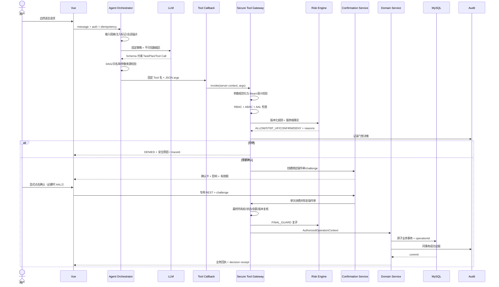

# 安全执行模型

## 1. 核心安全不变量

无论模型是否正常、是否被 Prompt Injection、是否产生幻觉，系统都必须保持：

1. LLM 不能直接访问数据库、Repository、领域写 Service、网络或任意代码执行能力。
2. 未注册 Tool、未授权资源、未知资源 ID、无证据参数和 Schema 外字段不能进入业务 Service。
3. 所有资金、理财购买、卡片状态/控制和订阅取消在用户明确确认前无业务副作用。
4. 用户确认只对屏幕上展示的不可变操作摘要有效，参数变化后原确认立即失效。
5. 相同逻辑请求和确认重放最多产生一次业务效果。
6. 允许、待确认、拒绝、失败都产生结构化决策凭证和追加式审计。
7. Redis、模型或前端故障不能导致安全检查被跳过；无法确认安全事实时 fail closed。
8. 模型可见 Tool 集合不是授权边界；每次实际执行都必须再次通过服务端 Capability/Tool Policy 成员校验。

## 2. 信任边界

| 输入/组件 | 信任级别 | 处理方式 |
|---|---|---|
| 系统安全策略、编译进应用的 Tool Registry | 高 | 版本化、启动校验、不可由对话修改 |
| 服务端认证 Principal、数据库业务事实 | 条件可信 | 每次执行重取，带版本/时间，最小化暴露 |
| LLM 输出、TaskPlan、Tool 参数 | 不可信 | JSON Schema、白名单、语义校验、资源锚点 |
| 用户输入、历史消息 | 不可信 | 长度/速率限制、内容标签、注入检测，不作为权限事实 |
| 商户名、交易描述、收款人备注、Tool 数据 | 不可信数据 | 与指令区隔离，转义/长度限制，不能触发 Tool |
| 前端提交的 ID、challenge、Idempotency-Key | 不可信 | 所有权、绑定哈希、CSRF/重放、格式校验 |
| Redis 缓存 | 可丢失/可能过期 | 只作加速；关键事实回源 MySQL 或安全拒绝 |

### Allowed Tool Set

- 每轮请求基于服务端 Principal、AAL、会话/操作状态、渠道、feature flags、profile 和策略版本计算 Allowed Tool Set。
- 只向模型传递该集合的 request-level ToolCallback，不注册高风险/写操作 `defaultTools`。
- Tool 可见性只能减少模型误调用，不能授权执行。Gateway 在参数校验前先对 `(toolName, version)` 做同一策略的执行端成员检查，并在后续权限/风险阶段继续检查。
- 策略快照有 decision ID、hash、有效期；身份、AAL、会话或 feature flag 变化会使快照失效。
- 成员检查失败记录 `CAPABILITY_TOOL_NOT_ALLOWED`，后续 Service 必须为 `NOT_CALLED`。

## 3. 端到端执行顺序



参数校验、权限检查、风险检查的任一拒绝都会在 Service 之前结束。最终复核不是绕回模型，而是用相同规范化参数和最新服务端事实防止 TOCTOU。

## 4. 参数校验

校验分四层并收集安全原因码：

1. **JSON 结构**：拒绝未知/重复字段、类型错误、过深 JSON、超长数组/字符串、非有限数值。
2. **Bean/格式**：UUID、ISO 日期、币种、金额精度、枚举、分页边界。
3. **领域语义**：日期先后、金额范围、账户币种、卡片限额关系、产品递增金额、合法状态转换。
4. **来源与新鲜度**：资源 ID 是否来自当前用户已授权证据锚点，preview/suitability 是否未过期且 argsHash 一致。

资源锚点不是授权替代品；即使存在锚点，仍需回源验证所有权。未知 ID 返回 `RESOURCE_NOT_AVAILABLE`，避免通过不同错误枚举他人资源。

## 5. 权限分级

### 5.1 认证等级

| 等级 | 能力 | 取得方式（演示） |
|---|---|---|
| `AAL0` | 健康检查、公开产品概览 | 未登录 |
| `AAL1` | 本人账户/账单查询、创建待确认操作 | 用户名密码登录，有时效会话 |
| `AAL2` | 高金额、新收款人、理财购买、卡片解冻/放宽控制 | 模拟 OTP/二次验证，短时有效并绑定会话 |

确认代表“同意这项操作”，AAL2 代表“更强地确认操作者身份”，两者不能互相替代。OTP 不通过聊天文本传给模型。

### 5.2 RBAC 权限

`ACCOUNT_VIEW`、`TRANSACTION_VIEW`、`TRANSFER_CREATE`、`INVESTMENT_VIEW`、`INVESTMENT_BUY`、`CARD_VIEW`、`CARD_MANAGE`、`SUBSCRIPTION_VIEW`、`SUBSCRIPTION_MANAGE`、`AUDIT_VIEW_OWN`、`SANDBOX_RESET`。

### 5.3 ABAC 所有权与上下文

- `resource.user_id == principal.user_id`，或资源通过账户/订单可传递归属本人。
- 用户、账户、卡片、收款人、订阅必须处于允许的状态。
- 操作单、确认 challenge、会话和审计 Trace 均属于同一 Principal。
- 认证会话未撤销，AAL2 未过期且风险动作与会话绑定。
- Demo Admin 可以重置数据集，但默认不能代客户执行资金操作。

## 6. 风险规则引擎

规则输入只来自已校验参数、认证上下文、MySQL 事实、可靠时钟和可回源的速度统计。LLM 不能提供风险分数或覆盖规则。

### 决策优先级

```text
DENY > REQUIRE_STEP_UP > REQUIRE_CONFIRMATION > ALLOW
```

当前范围的写操作有一条基础策略 `WRITE_CONFIRM_001`，因此最低结果也是 `REQUIRE_CONFIRMATION`。`REQUIRE_STEP_UP` 完成后仍需确认。

### 演示规则集 v1

| 规则码 | 条件 | 结果 | 可展示原因 |
|---|---|---|---|
| `WRITE_CONFIRM_001` | 任一受保护写操作 | CONFIRM | 此操作会改变资金或账户设置，需要本人确认 |
| `TRANSFER_BALANCE_001` | 金额 + 手续费 > 可用余额 | DENY | 可用余额不足 |
| `TRANSFER_LIMIT_002` | 金额 > 当日剩余额度 | DENY | 超过当日可用转账额度 |
| `TRANSFER_STEPUP_003` | 金额 > CNY 10,000 或收款人从未使用 | STEP_UP | 大额或新收款人需要加强认证 |
| `TRANSFER_VELOCITY_004` | 10 分钟成功/待执行转账 ≥ 3 或累计 > CNY 20,000 | DENY | 短时间操作过于频繁，请稍后或人工核验 |
| `TRANSFER_STATE_005` | 账户/收款人非可用状态或币种不匹配 | DENY | 账户或收款信息当前不可用于转账 |
| `INVEST_SUITABILITY_001` | 产品风险等级高于用户有效风险等级 | DENY | 当前风险测评不匹配该产品 |
| `INVEST_PROFILE_002` | 风险测评缺失或过期 | DENY | 需先完成有效风险测评 |
| `INVEST_PRODUCT_003` | 产品停售/不在有效期/金额不符门槛 | DENY | 产品状态或购买金额不符合要求 |
| `INVEST_STEPUP_004` | 任一理财购买 | STEP_UP | 理财购买需要加强认证与确认 |
| `CARD_TRANSITION_001` | 非法状态转换或 CLOSED 卡片 | DENY | 当前卡片状态不允许该操作 |
| `CARD_STEPUP_002` | 解冻、开启境外/线上能力或提高限额 | STEP_UP | 放宽卡片安全控制需要加强认证 |
| `SUBSCRIPTION_STATE_001` | 订阅非 ACTIVE/PAUSED 或不可取消 | DENY | 当前订阅无需或无法取消 |
| `SECURITY_INJECTION_001` | 计划请求未知 Tool/跳过门禁/伪造 Tool 结果 | DENY | 请求包含不受支持的执行指令 |

比赛阈值属于 Mock 策略配置，不宣称为真实银行风控规则。规则按版本新增，不原地修改已生效版本；决策记录保存 policy version、输入 hash 和命中 finding。

### 最终复核

确认后、执行前重新检查：Principal、AAL、operation/challenge 状态、argsHash、资源所有权/状态/version、余额、当日额度、产品/订阅/卡片状态、速度规则。策略或业务前置条件不再满足时标记为 `DENIED`；基础设施异常时标记为 `FAILED` 并带安全 failure code。两种情况都不调用 Service，并解释“确认后状态已变化”或安全失败原因。

## 7. 用户确认模型

1. 安全门禁通过后创建不可变 `OperationRequest` 和随机 256-bit challenge。
2. 仅保存 challenge hash；响应中的一次性 token 通过 HTTPS 返回前端。
3. 确认卡由服务端模板显示 before/after、金额、费用、目标、风险提示和有效期。
4. 绑定值：`HMAC(userId | operationId | toolVersion | argsHash | summaryHash | expiresAt | nonce)`。
5. 确认接口不接受任何业务参数，只接受 operation ID、challenge、明确 `confirmed=true` 和需要时的 AAL2 证明。
6. 默认 5 分钟过期；取消、超时、参数变化、用户/会话变化立即失效。
7. 数据库条件更新/行锁保证 challenge 只能消费一次；消费后即使业务失败也不能重放，需要查询状态或重新发起。

聊天中的“确认”“好的”或引用文本不能直接执行。Agent 只能返回结构化确认卡，最终确认来自受 CSRF 防护的专用 REST 事件。

## 8. 幂等性与并发

系统使用三道幂等屏障：

1. **请求级**：聊天消息/REST 请求携带 `Idempotency-Key`；同 key 同 requestHash 返回同响应，同 key 异参返回 `IDEMPOTENCY_KEY_REUSED`。
2. **计划步骤级**：`SHA-256(userId | conversationId | planId | stepId | tool | argsHash)` 生成逻辑执行 key，模型重试 Tool Call 返回已有操作单。
3. **领域级**：`transfer_order`、`investment_order`、`card_change_history`、`subscription_action` 的 `operation_id UNIQUE`，阻止重复业务效果。

并发确认使用 compare-and-set/行锁；资金操作锁定相关账户并按稳定 ID 顺序加锁，避免死锁。相同 operation 只允许一个执行者，其余请求查询已存在结果。数据库超时后的客户端不得创建新 key 猜测结果，应先调用 `operation.get_status`。

## 9. Prompt Injection 防御

### 输入与 Prompt 隔离

- 系统策略模板只从只读资源加载并带版本/hash，用户不能覆盖。
- 用户消息、历史内容、交易描述和商户名均包在明确的不可信数据结构中，不拼接成系统指令。
- 不向模型提供密钥、数据库结构细节、完整安全 Prompt、完整账号卡号或 OTP。
- 检测“忽略规则”“伪造调用结果”“直接改库”“调用未列工具”“泄漏系统提示”等模式，产生安全标签和审计；检测只是附加层，不是唯一防线。

### 执行隔离

- Function Calling 使用精确白名单与 JSON Schema；不存在通用 HTTP、文件、SQL、Shell Tool。
- Agent 不能声明“已确认”；确认状态只从数据库读取。
- Tool 数据中的文本即使包含指令，也只能作为字符串返回，不能改变 Tool Registry 或计划。
- M3 每次运行最多 5 个模型轮次、每轮 4 次且总计 12 次 Tool Call；相同调用不能重复，模型/Tool 都有独立超时和上下文限制。

### M4 已落地的转账安全闭环

- 模型最多调用 `prepare_transfer`，该 Tool 的成功含义固定为“操作已准备”，不是“转账成功”。
- Gateway 的事务覆盖操作单、风险决策、challenge 与 Tool Security Audit；审计失败时准备操作整体回滚。
- 确认 body 必须精确为 `challengeId + confirmed`；出现 `amount`、`payeeId` 等额外字段直接 400，不能在确认阶段换参。
- ≥ 10,000 CNY、非可信或从未使用的收款人要求 AAL2；所有转账都要求显式确认。
- 最终确认重新检查 owner、challenge、有效期、AAL、参数/摘要哈希、账户/收款人状态、余额、币种、日限额和频率。
- 成功、拒绝和重放分别返回稳定 reason code；并发确认由操作行悲观锁和 `operation_id` 唯一回执共同约束。
- 显式配置 `spring.ai.tools.resolution.fallback.enabled=false`、`spring.ai.chat.client.tool-calling.enabled=false`，并在 Spring AI request options 设置 `internalToolExecutionEnabled=false`；当前已由应用控制 Tool Calling Loop。

### M5 已落地的卡片、订阅与理财闭环

- `prepare_card_status_change`、`prepare_card_controls_change`、`prepare_subscription_cancellation`、`prepare_wealth_purchase` 都是 `PREPARE_WRITE`，成功仅表示操作单与 challenge 已创建。
- 最终变更统一由 `/api/v1/operations/{operationId}/confirm` 进入 `OperationCommandRouter`；Registry、Agent 候选集合和模型 Schema 中不存在最终执行器。
- 卡片状态转换由固定状态机验证；解冻、启用支付能力或提高限额需要 AAL2，冻结/收紧仍需 AAL1 加明确确认。
- 订阅成本按固定周期换算公式由 Java 计算；取消时复查 owner、状态与版本，并写入追加式变更历史。
- 适当性证据精确绑定用户、风险等级、产品、账户、金额、币种和资源版本，十分钟过期；购买始终要求 AAL2，确认时再次复查产品状态、风险等级、余额和版本。
- 成功写入与 `operation_request`、challenge、风险决策、业务回执/历史、`operation_audit` 在同一 MySQL 事务中完成；确认重放返回原回执，不重复产生业务效果。
- 拒绝使用稳定原因码，例如 `AAL2_REQUIRED`、`CARD_TRANSITION_INVALID`、`RESOURCE_VERSION_CHANGED`、`SUBSCRIPTION_NOT_CANCELLABLE`、`SUITABILITY_BINDING_MISMATCH`、`RISK_PROFILE_EXPIRED`、`PRODUCT_NOT_ON_SALE` 和 `INSUFFICIENT_FUNDS`。

### 输出隔离

- Grounding Guard 检查成功 Tool Evidence、关键数字和写操作回执；不一致时丢弃模型答案并使用确定性摘要或安全拒绝。
- UI 对模型文本做安全渲染，不执行 HTML/脚本，不把模型输出转换为 REST 动作。
- 模型声称“已完成”但没有 `SUCCEEDED` operation receipt 时，替换为安全响应：“尚未执行，请查看操作状态”。

### M6 已落地的跨场景执行边界

- 结构化意图与 DAG 模板由服务端确定性生成；模型不能提交或修改计划结构。
- `TaskPlanValidator` 强制最多 8 步、唯一步骤 ID、依赖存在且拓扑有序、Tool 属于当前 Capability 快照、声明模式与 Registry 摘要一致。
- 单计划最多一个 `PREPARE_WRITE`；多个写目标返回 `PLAN_WRITE_SCOPE_TOO_BROAD`，要求拆分任务。
- 每一模型轮次只暴露当前依赖已满足的节点，并重新签发 Allowed Tool Set；执行端仍由 Gateway 再次验证 `(toolName, version)`。
- 模型越序、调用隐藏最终执行器或伪造 Tool 时，Gateway 产生拒绝审计，计划进入 `REJECTED`，后续节点不执行。
- 查询失败、Provider/Tool 超时或异常会让计划进入 `PAUSED`；已完成查询 Evidence 可在同一用户会话中恢复，未确认写步骤没有业务副作用。
- `PREPARE_WRITE` 成功后立即停止 Agent Loop 并返回 `pendingActions`，状态为 `AWAITING_CONFIRMATION`；对话中的“继续/确认”不能代替独立确认 API。

## 10. 幻觉防护

- **ID 防幻觉**：账户/收款人/产品/卡片/订阅 ID 必须来自服务端锚点；伪造 UUID 在来源校验阶段拒绝。
- **数字防幻觉**：余额、账单汇总、费用、收益说明由 Tool 计算；模型不做最终金额运算。
- **状态防幻觉**：只有领域回执能声明成功。计划、预览、待确认都不能表述为已完成。
- **产品防幻觉**：只允许沙箱产品 ID；不存在的产品、利率或保本说法明确拒绝/纠正。
- **事实引用**：回答中的关键事实引用 evidence ID；证据过期或 Tool 失败时要求重新查询。
- **不确定性**：实体消歧有多个候选时必须追问，不能默认选择第一个。

## 11. 可解释决策凭证

每次 Tool Call 返回可展示的 Decision Receipt，UI 可展开阶段时间线：

```json
{
  "traceId": "tr_...",
  "operationId": "op_...",
  "finalOutcome": "DENIED",
  "stages": [
    {"stage": "PARAMETER_VALIDATION", "outcome": "PASS", "codes": ["SCHEMA_VALID"]},
    {"stage": "AUTHORIZATION", "outcome": "PASS", "codes": ["PERMISSION_GRANTED", "OWNERSHIP_CONFIRMED"]},
    {"stage": "RISK", "outcome": "DENY", "codes": ["TRANSFER_LIMIT_002"], "message": "超过当日可用转账额度"},
    {"stage": "SERVICE", "outcome": "NOT_CALLED", "codes": ["BLOCKED_BY_RISK"]}
  ],
  "policyVersion": "risk-demo-v1",
  "auditProof": {"lastEventHash": "sha256:..."}
}
```

允许结果会包含 `USER_CONFIRMATION_BOUND`、`FINAL_GUARD_PASSED`、`DOMAIN_TRANSACTION_COMMITTED` 和业务回执引用。拒绝解释公开安全、可行动的原因，但不返回其他用户是否存在、内部堆栈、密钥、完整反欺诈特征或系统 Prompt。

## 12. 审计事件

建议阶段：`REQUEST_RECEIVED`、`PROMPT_SCREENED`、`PLAN_VALIDATED`、`TOOL_SELECTED`、`PARAMETERS_VALIDATED`、`AUTHORIZATION_DECIDED`、`RISK_DECIDED`、`CONFIRMATION_CREATED`、`CONFIRMATION_DECIDED`、`FINAL_GUARD`、`SERVICE_EXECUTED`、`DATABASE_COMMITTED`、`RESPONSE_GROUNDED`。

- 每条记录含 actor、trace/operation、policy/tool/prompt version、outcome、reason code、脱敏详情和 request hash。
- 同一 Trace 使用 `previous_hash/event_hash` 形成顺序证据；业务应用账号无更新/删除审计权限。
- 成功审计与业务事务同提交。事务回滚后，以独立事务写 `SERVICE_FAILED`，明确标注未提交。
- 日志与审计分离：技术日志用于排障，审计表用于证明；两者都不保存口令、OTP、token、完整账号卡号和模型隐式推理。

## 13. 异常与降级

| 故障 | 行为 |
|---|---|
| 模型超时/非法 JSON | 不调用 Tool；安全提示重试，记录 `MODEL_OUTPUT_INVALID` |
| 未知 Tool/版本 | 默认拒绝并记录 `TOOL_NOT_ALLOWED` |
| Tool 查询超时 | 有限重试或失败；不让模型补造结果 |
| MySQL 不可用 | 所有业务失败；不使用缓存余额执行 |
| Redis 不可用 | 查询可回源；依赖速度风控/AAL 会话的写操作安全拒绝 |
| 确认过期/重放 | 不执行，返回新建操作建议 |
| 确认后余额/状态变化 | FINAL_GUARD 拒绝，展示状态变化原因 |
| 提交结果不确定 | 使用原 operation/idempotency 查询，不创建重复交易 |
| 审计写入失败 | 成功业务事务整体回滚；失败事件进入受控故障通道/技术告警 |
