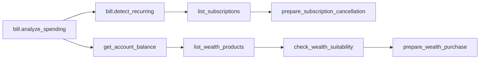

# Tool / Function Calling 定义

## 1. Tool 设计原则

- Tool 名称固定、版本化、默认不可见；每轮由 Capability/Tool Policy 计算 Allowed Tool Set，只把集合内 ToolCallback 注册给本次 Agent Run。
- 模型侧 Tool 可见性不是最终安全边界。即使 Tool 未暴露给模型，Gateway 仍必须验证 `(toolName, version)` 属于当前 Allowed Tool Set。
- Tool 参数不包含 `userId`、role、认证等级、确认状态、风险结果等安全事实，这些只来自服务端上下文。
- Tool 不接收 SQL、URL、Java 类名、任意表达式、任意字段名或下一个 Tool 名称。
- 业务资源使用服务端 UUID，且必须来自当前会话中已授权、已展示的证据锚点；不接受模型凭空生成的 ID。
- 所有字段启用 allowlist 和 `additionalProperties=false`；字符串有长度/字符集约束，金额使用十进制字符串。
- 查询 Tool 也要校验权限和所有权。写 Tool 只创建操作单或恢复相同幂等结果，不直接修改数据库。
- 跨场景通过 Planner 组合原子 Tool，不提供 `execute_anything`、`run_sql`、`call_url` 或万能 Tool。

## 2. 统一返回信封

### M2–M6 已实现的 Tool

| Tool | 参数 | Capability | 结果 |
|---|---|---|---|
| `get_accounts@1.0` | `{}` | `ACCOUNT_READ` | 本人脱敏账户列表 |
| `get_account_balance@1.0` | `accountId` | `ACCOUNT_READ` | 本人单账户账面/可用余额 |
| `list_transactions@1.0` | `accountId`, `from`, `to`, `limit?` | `TRANSACTION_READ` | 最多 100 条、最长 366 天本人流水 |
| `list_cards@1.0` | `{}` | `CARD_READ` | 本人脱敏卡片 |
| `list_payees@1.0` | `{}` | `PAYEE_READ` | 本人脱敏收款人 |
| `list_subscriptions@1.0` | `{}` | `SUBSCRIPTION_READ` | 本人订阅/代扣 |
| `list_wealth_products@1.0` | `riskLevelMax?`, `currency?`, `saleStatus?`, `limit?` | `WEALTH_PRODUCT_READ` | 最多 20 个模拟产品 |

这些 Handler 没有 Repository 依赖；身份只取自 `ToolExecutionContext`。M3 的 `SpringAiToolSchemaCatalog` 从同一 Handler 参数类型和 `ToolDefinition` 生成 JSON Schema，并只处理当前 snapshot 成员。

M4 新增两个显式注册项：

| Tool ID | 模式 | 参数 | 结果与边界 |
|---|---|---|---|
| `prepare_transfer@1.0` | `PREPARE_WRITE` | `sourceAccountId`, `payeeId`, `amount`, `currency`, `purpose?` | 校验并创建待确认操作/挑战；`confirmationRequired=true`；绝不扣款 |
| `get_operation_status@1.0` | `READ_ONLY` | `operationId` | 只读取当前用户自己的操作状态、确认入口和回执引用 |

`prepare_transfer` 的 `Idempotency-Key` 来自受信任 HTTP/Agent 执行上下文，不在模型可填写的 Tool 参数中。最终转账执行器不是 Tool，不在 Registry 和模型 Schema 中。

M5 新增 8 个显式注册项：

| Tool ID | 模式 | Capability | 结果与边界 |
|---|---|---|---|
| `get_card_controls@1.0` | `READ_ONLY` | `CARD_READ` | 本人卡片控制与资源版本 |
| `prepare_card_status_change@1.0` | `PREPARE_WRITE` | `CARD_MANAGE` | 冻结/解冻/挂失预览；解冻要求 AAL2 |
| `prepare_card_controls_change@1.0` | `PREPARE_WRITE` | `CARD_MANAGE` | 线上/境外/限额 before-after；放宽要求 AAL2 |
| `analyze_subscription_costs@1.0` | `READ_ONLY` | `SUBSCRIPTION_READ` | Java 确定性月度等值与年化成本 |
| `prepare_subscription_cancellation@1.0` | `PREPARE_WRITE` | `SUBSCRIPTION_MANAGE` | 取消预览和预计生效时间 |
| `check_wealth_suitability@1.0` | `READ_ONLY` | `WEALTH_SUITABILITY` | 持久化短期决策证据，不扣款、不建仓 |
| `get_wealth_portfolio@1.0` | `READ_ONLY` | `WEALTH_PRODUCT_READ` | 本人持仓；初始 Sandbox 为空 |
| `prepare_wealth_purchase@1.0` | `PREPARE_WRITE` | `WEALTH_PURCHASE` | 绑定适当性证据的购买预览；始终要求 AAL2 |

所有 `prepare_*` 的最终执行器都不在 Registry，不会出现在模型 Tool Schema；HTTP/Agent 上下文提供的幂等键也不能由模型参数覆盖。

```json
{
  "invocationId": "...",
  "requestId": "...",
  "snapshotId": "...",
  "toolName": "prepare_transfer",
  "toolVersion": "1.0",
  "decision": "ALLOW",
  "reasonCode": "WRITE_OPERATION_PREPARED",
  "explanation": "仅生成待确认操作；尚未发生资金或状态变更",
  "data": {
    "operationId": "...",
    "status": "AWAITING_CONFIRMATION",
    "requiredAal": "AAL1",
    "challengeId": "...",
    "confirmEndpoint": "/api/v1/operations/.../confirm"
  },
  "recordCount": 1,
  "completedAt": "2026-09-02T12:00:00Z"
}
```

`status` 只允许：

- `SUCCESS`
- `NEEDS_CLARIFICATION`
- `AWAITING_STEP_UP`
- `AWAITING_CONFIRMATION`
- `DENIED`
- `FAILED`

Tool 结果中的 `summary`、`reasons` 和 `evidence` 由服务端模板生成，不使用模型自由文本生成。模型可以转述，但最终回答必须保留 Trace ID/操作 ID，并受 Grounding Validator 检查。

## 3. Tool 注册元数据

每个 Tool 在注册表中声明：

```text
name, version, mode(READ/WRITE), inputSchemaHash, outputSchemaHash,
requiredPermission, minimumAal, confirmationPolicy,
riskPolicySet, timeout, maxCallsPerRun, enabledProfiles
```

Tool Registry 启动时校验重复名称、版本、Schema hash 和实现签名；运行时只按 `(name, version)` 精确匹配。未知或已下线版本返回 `TOOL_NOT_ALLOWED` 并写安全审计。

Capability Policy 的输出不是一个裸字符串列表，而是包含 `decisionId`、`policyVersion`、`snapshotHash`、`expiresAt` 和精确 `(name, version)` 集合的服务端对象。Agent 暴露 Tool 前检查一次，Gateway 执行前再检查一次；执行检查不能被 ToolCallbackProvider、模型输出或请求参数覆盖。

## 4. Tool 清单

### 4.1 账户、收款人与账单（只读）

| Tool | 主要输入 | 确定性输出 | 权限/约束 |
|---|---|---|---|
| `account.list_owned` v1.0 | `includeClosed=false` | 本人账户 ID、别名、掩码、类型、币种、状态 | `ACCOUNT_VIEW`；最多 20 条 |
| `account.get_summary` v1.0 | `accountId` | 账面/可用余额、当日转账剩余额度、数据时间 | `ACCOUNT_VIEW` + 所有权；ID 必须是已授权锚点 |
| `beneficiary.search_owned` v1.0 | `query`, `currency?`, `limit<=10` | 本人收款人候选、掩码、是否可信、最近使用时间 | `TRANSFER_CREATE` + 所有权；模糊匹配无唯一结果时要求澄清 |
| `bill.list_transactions` v1.0 | `accountId`, `dateFrom`, `dateTo`, `category?`, `direction?`, `pageToken?`, `pageSize<=100` | 脱敏流水页与 evidence IDs | `TRANSACTION_VIEW` + 账户所有权；跨度最多 366 天 |
| `bill.analyze_spending` v1.0 | `accountIds[]`, `dateFrom`, `dateTo`, `compareMode`, `groupBy` | 收支总额、分类、商户、趋势、对比、样本数 | Java 计算；账户均属于本人；无样本明确返回 |
| `bill.detect_recurring` v1.0 | `accountIds[]`, `lookbackDays(30..366)` | 周期扣款候选、置信分、周期、估计年成本、证据流水 | 规则算法；不自动创建/取消订阅 |

`compareMode`: `NONE`、`PREVIOUS_PERIOD`、`PREVIOUS_MONTH`。`groupBy`: `CATEGORY`、`MERCHANT`、`MONTH`。所有统计金额由 Tool 计算，不允许 Agent 将流水列表自行求和作为最终事实。

### 4.2 智能转账

| Tool | 主要输入 | 确定性输出 | 权限/确认 |
|---|---|---|---|
| `prepare_transfer` v1.0 | `sourceAccountId`, `payeeId`, `amount`, `currency`, `purpose?` | 收付款掩码、金额、操作 ID、challenge、有效期、所需 AAL | `TRANSFER_PREPARE`；本人账户/收款人；始终确认；只准备不扣款 |
| `get_operation_status` v1.0 | `operationId` | 状态、所需 AAL、过期时间、确认入口、回执引用 | `OPERATION_READ`；只读本人操作 |

关键参数规则：

- `amount`: JSON 十进制数或十进制字符串，正数，最多 2 位小数，最大 `1000000.00`；解析为 BigDecimal。
- `currency`: 当前仅 `CNY`，必须与来源账户、收款人和 preview 一致。
- `purpose`: 可选，最多 120 字，只作备注，绝不作指令。
- 操作和 challenge 默认 5 分钟有效，绑定用户、规范化参数哈希与展示摘要哈希；确认端点不接受业务参数。

执行成功后返回服务端转账回执、余额证据和审计 Trace；模型不能自行宣布“已到账”。

### 4.3 理财

| Tool | 主要输入 | 确定性输出 | 权限/确认 |
|---|---|---|---|
| `list_wealth_products` v1.0 | `riskLevelMax?`, `currency?`, `saleStatus?`, `limit?` | 产品 ID、风险级别、期限、门槛、模拟收益说明 | `WEALTH_PRODUCT_READ`；只返回沙箱产品 |
| `get_wealth_portfolio` v1.0 | `{}` | 本人持仓、成本、产品风险、数据时间 | `WEALTH_PRODUCT_READ` + 所有权 |
| `check_wealth_suitability` v1.0 | `productId`, `paymentAccountId`, `amount`, `currency` | 用户/产品风险快照、门槛/余额结论、检查 ID 与有效期 | `WEALTH_SUITABILITY`；本人账户；只写决策证据 |
| `prepare_wealth_purchase` v1.0 | `suitabilityCheckId`, `productId`, `paymentAccountId`, `amount`, `currency` | 创建/返回购买操作单与确认卡 | `WEALTH_PURCHASE`；始终 AAL2 + 确认 |

风险等级不匹配、问卷过期、产品停售、未达到起购/递增金额或余额不足均由服务端拒绝。`expectedYieldText` 是模拟产品说明，不由 LLM 推导保本或承诺收益。

### 4.4 卡片管理

| Tool | 主要输入 | 确定性输出 | 权限/确认 |
|---|---|---|---|
| `list_cards` v1.0 | `{}` | 卡片 ID、掩码、类型、状态、关联账户掩码 | `CARD_READ` + 所有权 |
| `get_card_controls` v1.0 | `cardId` | 线上/境外开关、单笔/日限额、版本 | `CARD_READ` + 所有权 |
| `prepare_card_status_change` v1.0 | `cardId`, `targetStatus`, `reasonCode` | 创建状态变更操作单与影响摘要 | `CARD_MANAGE`；始终确认；解冻需要 AAL2 |
| `prepare_card_controls_change` v1.0 | `cardId`, `onlineEnabled`, `overseasEnabled`, `singleTxLimit`, `dailyLimit` | 创建控制变更操作单，展示 before/after | `CARD_MANAGE`；始终确认；放宽控制需要 AAL2 |

`targetStatus` 只允许 `ACTIVE`、`FROZEN`、`LOST`；关闭卡片不在比赛自助 Tool 范围。至少有一个控制字段变化，限额为 CNY 十进制字符串，单笔不得高于日限额。重复设置同一状态返回原操作结果或 `NO_CHANGE`，不重复写历史。

### 4.5 订阅/代扣

| Tool | 主要输入 | 确定性输出 | 权限/确认 |
|---|---|---|---|
| `list_subscriptions` v1.0 | `{}` | 本人订阅、金额、周期、下次扣款、状态 | `SUBSCRIPTION_READ` + 所有权 |
| `analyze_subscription_costs` v1.0 | `subscriptionIds?`, `horizonMonths(1..12)` | 月度等值、年化/区间总成本、各订阅明细 | `SUBSCRIPTION_READ`；Java 计算；仅本人订阅 |
| `prepare_subscription_cancellation` v1.0 | `subscriptionId`, `reasonCode` | 创建取消操作单，展示生效时间和影响 | `SUBSCRIPTION_MANAGE`；始终确认 |

只有 `ACTIVE/PAUSED` 的可取消订阅允许生成取消操作单；已取消返回幂等结果。检测到的周期流水若尚未成为已验证订阅，只能提示用户，不能直接调用取消。

### 4.6 操作与解释（只读）

| Tool | 主要输入 | 确定性输出 | 权限/约束 |
|---|---|---|---|
| `get_operation_status` v1.0 | `operationId` | 本人操作状态、确认有效期、业务回执或安全错误 | `OPERATION_READ`；不泄露内部堆栈 |
| `audit.explain_decision` v1.0 | `operationId?`, `traceId?` 二选一 | 参数、权限、风险、确认、执行各阶段的决策凭证 | `AUDIT_VIEW_OWN`；仅本人、脱敏、安全原因码 |

确认和取消不是模型 Tool。前端必须调用专用 REST 接口并提交服务端发出的 challenge；这样交易不会因模型误判一句“好的”或恶意文本中的“确认”而执行。

## 5. 跨场景组合规则

跨场景没有万能 Tool，M6 仍维持 17 个显式原子 Tool，由服务端 TaskPlan DAG 编排。例如：



- 查询节点可以在依赖满足后自动运行。
- 写节点只能生成操作单，默认分别确认。
- 允许批量确认时，必须把全部操作 ID、顺序、before/after、金额与总影响绑定进同一个不可变批次哈希；用户可取消任一项。
- 某一步失败时停止所有依赖步骤，独立已完成查询无需回滚；未确认写步骤全部保持零副作用。
- 不使用 LLM 生成补偿交易。若已执行步骤需要撤销，必须调用未来显式定义的反向业务 Tool；当前范围不自动撤销。
- 当前实现最多 8 步且单计划最多一个 `PREPARE_WRITE`；每轮只向模型发送依赖已满足节点的 schema，模型不能自行提交 DAG。

## 6. 参数规范化与变量绑定

Gateway 在哈希和幂等前执行规范化：

- UUID 转小写规范格式；币种转大写；金额按币种 scale 规范为 `800.00`。
- 字符串做 Unicode NFC、首尾空白清理和长度限制；不改变具有业务意义的中间字符。
- JSON key 按字典序，拒绝未知字段和重复 key。
- 下游步骤用 `${steps.s1.data.beneficiaryId}` 形式的服务端变量引用。解析器只读取真实 Tool Result，不从自然语言消息读取。

规范化后生成 `argsHash = SHA-256(canonical-json)`。预览、操作单、确认挑战、幂等记录和审计都引用同一 hash。

## 7. Spring AI 集成边界

- 当前 Spring Boot 3.5 基线使用 Spring AI 1.1.8；2.x 面向 Spring Boot 4，因此未升级到 2.x。
- `BankingModelClient` 是厂商无关端口；`SpringAiBankingModelClient` 直接调用低层 `ChatModel`，不使用 ChatClient 自动循环。
- 不配置共享 `defaultTools`。每次请求只把 `AllowedToolSetSnapshot` 中的定义转换为 definition-only `ToolCallback`；callback 被调用会抛错，不包含数据库或 Gateway 执行逻辑。
- 同时保持 `spring.ai.chat.client.tool-calling.enabled=false`，并在每次请求设置 `internalToolExecutionEnabled=false`。模型 Tool Call 由应用解析后显式交给 `SecureToolGateway`。
- 关闭缺失 Tool 的 fallback name resolution（`spring.ai.tools.resolution.fallback.enabled=false`），防止模型请求未传入本轮白名单的 bean Tool。
- Tool Result 由应用构造 `ToolResponseMessage` 回传；系统提示明确数据字段不能成为新指令。
- 单次 Agent Run 最多 5 轮、每轮 4 次、总计 12 次 Tool Call，并限制模型/Tool 超时、上下文长度和相同调用重复。
- Provider 配置只读取 `OPENAI_API_KEY`、`OPENAI_BASE_URL`、`OPENAI_MODEL` 环境变量；默认 `spring.ai.model.chat=none`。

上述选择依据 Spring AI 官方 Tool Calling/ChatModel 机制，并由适配器测试锁定“只发送定义、不自动执行”的行为。

## 8. 版本策略

- 兼容性字段新增使用同一 minor schema；删除/重命名/语义变更发布新 Tool major 版本。
- OperationRequest 永久记录执行时 Tool 版本和 Schema hash。
- 旧操作单只能由兼容执行器恢复；执行器下线则安全失败并要求重新创建，不偷偷迁移参数。
- Prompt 版本、Tool 版本、风险策略版本和数据集版本同时进入 Agent Run/审计，确保演示结果可复现。
